<div align="center">

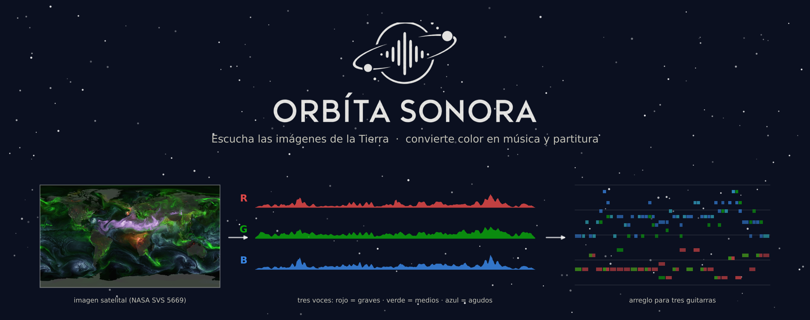

<br>

[](https://orbidataanalytics.github.io/Orbita_Sonora/)
[](https://orbitasonora.onrender.com/docs)


**Elige una imagen de la Tierra, escúchala y llévate su partitura para guitarra.**
Rojo = graves · Verde = medios · Azul = agudos

<br>

<table>
<tr>
<td align="center" width="50%">
<picture>
  <source media="(prefers-color-scheme: dark)" srcset="docs/informe/marca/logo-orbidata-analytics-blanco.png">
  
</picture>
<br><sub><b>Orbidata Analytics</b></sub>
</td>
<td align="center" width="50%">
<picture>
  <source media="(prefers-color-scheme: dark)" srcset="docs/informe/marca/logo-semillero-itm-blanco.png">
  
</picture>
<br><sub><b>Semillero de Astronomía, Instrumentación y Ciencias Espaciales del ITM</b><br>Medellín, Colombia</sub>
</td>
</tr>
</table>

</div>

---

## 🧭 Contenido

| | Para usar la web | | Para entender por dentro |
| --- | --- | --- | --- |
| 1 | [¿Qué es Órbita Sonora?](#1--qué-es-órbita-sonora) | 7 | [Metodología paso a paso](#7--metodología-paso-a-paso) |
| 2 | [Pruébalo en un minuto](#2--pruébalo-en-un-minuto) | 8 | [Cómo está hecho el frontend](#8--cómo-está-hecho-el-frontend) |
| 3 | [¿Cómo funciona? Explicado para niños](#3--cómo-funciona-explicado-para-niños) | 9 | [Cómo está hecho el backend](#9--cómo-está-hecho-el-backend) |
| 4 | [Todo lo que puedes hacer](#4--todo-lo-que-puedes-hacer) | 10 | [Resultados medidos](#10--resultados-medidos) |
| 5 | [De la luz al sonido: la idea](#5--de-la-luz-al-sonido-la-idea) | 11 | [Comparación con otras herramientas](#11--comparación-con-otras-herramientas) |
| 6 | [Trabajos relacionados y referentes](#6--trabajos-relacionados-y-referentes) | 12 | [Discusión](#12--discusión) · [Conclusiones](#13--conclusiones) |
| | | 14 | [Instalar, probar y publicar](#14--instalar-probar-y-publicar) |
| | | 15 | [Uso de inteligencia artificial y ética](#15--uso-de-inteligencia-artificial-y-ética) |
| | | 16 | [Licencias y créditos](#16--licencias-y-créditos) · [Referencias](#17--referencias-ieee) |

---

## 1. 🌍 ¿Qué es Órbita Sonora?

Órbita Sonora es una página web que **lleva imágenes al campo de la música**, dividiéndola en recuadritos o pixeles y convierte el color de cada pixel en sonido. Con esos sonidos compone una **canción para tres instrumentos** y escribe su **partitura con tablatura**, lista para tocar o imprimir.

* 🔴 El **instrumento rojo** toca los bajos.
* 🟢 El **instrumento verde** alterna el bajo con la melodía.
* 🔵 El **instrumento azul** toca las notas agudas.

Funciona completamente en el navegador y no hay que instalar nada. Está pensada para **aulas, divulgación científica, creación musical, aumentar capacidades e inclusión de personas con vista reducida que pueden escuchar las imagenes**.

**En números** (las 9 imágenes del catálogo, con los ajustes que trae la web):

<div align="center">

| 🎼 Compases por imagen | 🎵 Notas por canción | ✅ Notas dentro del acorde | 🎸 Traste máximo | ⚡ Análisis + composición | 🔊 Audio de 24,7 s listo en |
| :---: | :---: | :---: | :---: | :---: | :---: |
| **7** | **107 – 135** | **100 %** | **7** | **≈ 2 ms** | **0,17 – 0,30 s** |

</div>

---

## 2. ▶️ Pruébalo en un minuto

1. Abre **[el visor en línea](https://orbidataanalytics.github.io/Orbita_Sonora/)** en Chrome, Edge, Firefox o Safari.
2. En **Imágenes para escuchar**, toca una imagen. También puedes usar la tuya con **Cargar imagen**.
3. Pulsa **▶ Tocar arreglo** o el botón verde de la rocola. Un cursor recorre la imagen y la partitura mientras suena.
4. Cambia **Recorrido** a **Curva de Hilbert** y vuelve a tocar. Son los mismos colores en otro orden, y la canción cambia.
5. En **Partitura musical** descarga **MusicXML**, **MIDI** o **WAV**, o imprime en **PDF**.

### Dos imágenes para empezar

<table>
<tr>
<td width="50%" valign="top">

**🌃 Luces nocturnas 2012–2023** (NASA SVS 5313)

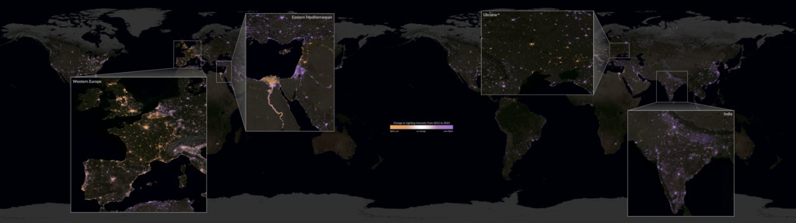

Deja la cuadrícula en **32 × 32**, empieza con **Líneas por filas** y luego cambia a **Curva de Hilbert**. Oirás los mismos píxeles en otro orden. [Fuente NASA SVS](https://svs.gsfc.nasa.gov/5313/)

</td>
<td width="50%" valign="top">

**🌫️ Aerosoles GEOS 2025** (NASA SVS 5669)


Compara la **Zona sonora** de 5 × 5 con la de 9 × 9. En los tramos de más contraste, la guitarra divide el pulso en notas más cortas. [Fuente NASA SVS](https://svs.gsfc.nasa.gov/5669/)

</td>
</tr>
</table>

> [!TIP]
> ¿Quieres usarla sin internet? En Windows abre `ABRIR_ORBITA.bat`. En cualquier sistema ejecuta `python3 scripts/abrir_local.py` y entra a <http://127.0.0.1:8000/>.

---

## 3. 🧒 ¿Cómo funciona? Explicado para niños

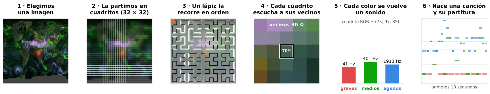

| Paso | Explicado| Lo que pasa por dentro |
| :---: | --- | --- |
| **1** 🖼️ | Escogemos una de la Tierra por ejemplo  del Centro de Información Terrestre (EIC). | Se abre la imagen (JPG, PNG, video, FITS, RAW o GeoTIFF) y se convierte a colores RGBA. |
| **2** 🔲 | Lo cortamos en muchos pixeles, como un rompecabezas de 32 por 32 piezas. | La imagen se reduce a una cuadrícula *N × N* (de 8 a 128) y cada pixel guarda su rojo, verde y azul. |
| **3** ✏️ | Un lápiz pasa por todos los cuadritos, uno detrás de otro, sin saltarse ninguno. El camino puede ser en filas, en zigzag, en espiral o en forma de laberinto (Hilbert). | Un **recorrido** decide el orden en que se escuchan las celdas. Ese orden se vuelve el tiempo de la canción. |
| **4** 👂 | Cada cuadrito escucha a sus vecinos para no gritar solo: se queda con 70 % de su color y toma 30 % de los vecinos. | **Media zonal 70/30** y medida del **contraste**. Mucho contraste hace que la guitarra toque notas más rápidas. |
| **5** 🎨➡️🎵 | Cada color tiene su voz: el rojo canta grueso (grave), el verde en el medio y el azul finito (agudo). Más color es una nota más alta. | Cada banda de color se convierte en una **frecuencia** (en Hz) y luego en una nota musical. |
| **6** 🎸 | Tres guitarras tocan juntas y la computadora escribe la partitura para que tú también la toques. | Se eligen acordes por color, ritmo por contraste y posición en el diapasón; luego se crean el audio, el MIDI y la partitura. |

### Un cuadrito de verdad, de principio a fin

Este es un cuadrito real de la imagen de aerosoles (columna 21, fila 15), con los números que calcula el programa:

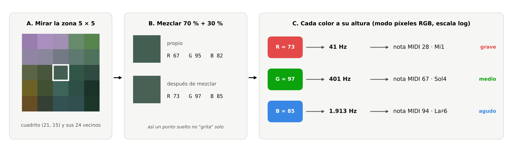

> [!NOTE]
> Este es el **modo píxeles RGB**: cada color suena con su frecuencia exacta. En el **modo arreglo**, que viene por defecto, esas mismas medidas se ajustan a los acordes y al diapasón de la guitarra, para que la música sea tocable.

---

## 4. 🎛️ Todo lo que puedes hacer

| Zona de la página | Botones y controles | ¿Para qué sirve? |
| --- | --- | --- |
| 🎶 **Rocola** | Vinilo · ▶ verde · Ⅱ rojo | Tocar o pausar rápido |
| 🛰️ **Imagen destacada** | GOES‑19 GeoColor · **Abrir MP4** | Ver la imagen satelital de hoy sobre Colombia o abrir un video |
| 🖼️ **Imágenes para escuchar** | 9 paquetes de NASA | Elegir qué escuchar |
| ⏯️ **Reproducción** | Tocar arreglo · Pausa · **Informe con partitura** · Tempo (40–168) · Tónica · Volumen | Controlar la música |
| ✏️ **Recorrido** | Recorrido (5) · Cuadrícula (8–128) · Velocidad (0,5–2×) · Zona sonora (1–21) | Decidir cómo se lee la imagen |
| 🎼 **Partitura musical** | Vista · ‹ › · Ir al compás · Seguir reproducción · WAV · MIDI · MusicXML · Imprimir/PDF | Leer, seguir y descargar la partitura |
| 🎹 **Ajustes de composición** | Mayor/menor · Alturas por acorde · Dificultad inicial/intermedia · Compás 4/4, 3/4 o 6/8 · Ritmo · Afinación | Cambiar las reglas de la canción |
| 🎤 **Voz** | Activar voz y letra · Añadir una voz grabada | Añadir una parte cantada y una letra editable |
| 🎚️ **DAW · Instrumentos** | Instrumento, volumen, panorama, Solo, Mute, Probar · Reverb en el borde · Panorama según X · Filtro según Y | Mezclar como en un estudio |
| 🔬 **Análisis de la imagen** | Duración 12/24/48 s · Escala log/lineal · Firmas 4/8/16 · Ocupación | Ajustar el análisis |
| 🗺️ **Vista geográfica** | Píxel activo · Mapa 2D · Globo 3D · Georreferenciar | Ubicar la imagen sobre la Tierra |
| 🧹 **Fondo y área** | Quitar fondo uniforme · Solo área seleccionada · Delimitar área | Elegir qué cuadritos suenan |
| 📊 **Firmas RGB** | Firma del píxel · Ocupación · Marcar píxel · Exportar marcas SIG · Descargar datos | Estudiar la imagen con números |

**Ideas de uso**

* 🏫 **En clase de música**: pon la dificultad en *Inicial* (trastes hasta el 5) e imprime la partitura con tablatura.
* 🔭 **En divulgación**: escucha cómo cambian las luces nocturnas o los aerosoles. El recorrido *radial* va del centro hacia los bordes.
* 🧪 **Para explorar datos**: marca píxeles interesantes y expórtalos como **GeoJSON** con fila, columna, segundo de la canción y coordenadas.
* 🎧 **Para producir**: lleva el MIDI a tu DAW o el MusicXML a MuseScore, Finale o Sibelius.

---

## 5. 💡 De la luz al sonido: la idea

**Sonificación** es usar sonidos que no son palabras para representar datos [1], [2]. La técnica más común es el **mapeo de parámetros**: cada dato controla algo del sonido, y lo que más se usa es la altura de la nota [3]. Una imagen no tiene tiempo propio, así que hay que decidir **en qué orden** se recorre. Yeo y Berger llaman *barrido* (*scanning*) a recorrer toda la imagen con un camino fijo y *sondeo* (*probing*) a que la persona elija qué zona escuchar [4], [5]. También mostraron que el barrido línea a línea (*raster*) une de forma natural el mundo 2D de la imagen con el 1D del sonido [6].

En Órbita Sonora la palabra **“espectral”** tiene dos sentidos:

* 🌈 **Espectro de la imagen.** Cada píxel es una muestra de la luz en tres bandas: rojo, verde y azul. En GeoColor de GOES‑19 esas bandas combinan canales del instrumento ABI [24], [25]. En las luces nocturnas vienen de la radiancia de VIIRS [26].
* 🔊 **Espectro del sonido.** Cada banda de color va a una banda de frecuencias audibles **en el mismo orden que la luz**: el rojo (menor frecuencia de luz) a los graves y el azul (mayor frecuencia de luz) a los agudos.

Encima de la sonificación, el proyecto añade **música**: tonalidad, acordes, compás y digitación de guitarra. Es una decisión pensada para educar y divulgar, y su efecto sobre la fidelidad del dato se discute en la [sección 12](#12--discusión).

---

## 6. 📚 Trabajos relacionados y referentes

### Sonificación de imágenes

| Referente | Idea clave | Qué toma Órbita Sonora |
| --- | --- | --- |
| **The vOICe**, Meijer 1992 [7] | Pasa imágenes de cámara a sonido de forma invertible: columnas de izquierda a derecha, altura según la posición vertical y volumen según el brillo, hasta 64 × 64 píxeles y 16 grises. | El barrido temporal. Aquí la altura depende del **color** y hay recorridos no lineales. |
| **Yeo y Berger**, 2005–2006 [4]–[6] | Marco de *scanning* y *probing*; barrido *raster* para escuchar texturas. | Los cinco recorridos son *scanning*. Marcar píxeles y la vista hasta el cursor son *probing*. |
| **Chandra, “A Universe of Sound”**, NASA [9], [10] | Sonificaciones curadas de imágenes del espacio: barridos lineales, radiales o tipo radar. Brillo = volumen; posición vertical o color = altura. Estudio con 3 184 participantes [9]. | Usar imágenes científicas de NASA y pasar color a altura. La diferencia: allí el resultado es un video; aquí el usuario controla todo y obtiene la partitura. |
| **Revisión en astronomía**, Zanella et al. 2022 [8] | Casi 100 proyectos revisados; el mapeo de parámetros domina y falta evaluar con oyentes. | Marco para la discusión. |
| **Mapeos de magnitudes físicas**, Dubus y Bresin 2013 [3] | 179 publicaciones: la altura es el recurso más usado y pocas evalúan su eficacia. | Justifica pasar intensidad a frecuencia y la necesidad de pruebas con personas. |

### Síntesis a partir de imágenes

* **ANS de Evgeny Murzin (1938–1958)** y su simulador **Virtual ANS** [33]: la imagen se lee como un sonograma, donde el eje vertical es la frecuencia.
* **Photosounder** [32]: editor que trata la imagen como espectrograma y guarda WAV.

Estas herramientas crean el sonido **directamente del espectro**: cada fila es una frecuencia. Órbita Sonora **resume** cada cuadrito en tres números y los vuelve notas musicales.

### Sonificación de datos en la web y en Python

* **TwoTone** [31]: tablas a música en el navegador; su desarrollo está pausado desde 2023.
* **Highcharts Sonification Studio** [27]: hoja de cálculo, gráfica y sonido, con foco en accesibilidad.
* **STRAUSS** [28], **Astronify** [30] y **SonoUno** [29]: paquetes científicos en Python.

### Bases técnicas usadas

| Tema | Fuente | Dónde se usa |
| --- | --- | --- |
| Curva de Hilbert y localidad | [11], [12] | `web/js/recorridos.js` |
| Tablas de áreas sumadas (imagen integral) | [13], [14] | `web/js/visor/estadistica-zonal.js` |
| Percepción de la altura | [15], [16] | Escala logarítmica por defecto |
| Web Audio y Tone.js | [17], [18] | Síntesis y afinación |
| MusicXML y MIDI | [19], [20] | Partituras |
| MobileNet cuantizado a 8 bits | [21]–[23] | Letra opcional |

---

## 7. 🔬 Metodología paso a paso

La cadena es **determinista**: la misma imagen con los mismos ajustes da siempre la misma partitura y el mismo audio.


| Caja del diagrama | En palabras sencillas | Detalle técnico |
| --- | --- | --- |
| 🖼️ **1. Imagen** | Abrimos el dibujo. | Navegador o API, salida RGBA de máximo 1 600 px (§ 7.1) |
| 🔲 **2. Cuadritos** | Lo partimos en un rompecabezas. | Canvas *N × N*; cada celda dura *T/N²* segundos (§ 7.2) |
| 🧹 **3. Qué cuadritos suenan** | Lo transparente o el fondo se queda callado. | Alfa, fondo uniforme o polígono (§ 7.3) |
| ✏️ **4. Orden de lectura** | Elegimos el camino del lápiz. | Filas, serpentina, Hilbert, radial o zigzag (§ 7.4) |
| 👂 **5. Escuchar a los vecinos** | Cada cuadrito suaviza su color con los de al lado. | Media 70/30 y contraste con imagen integral (§ 7.5) |
| 🎨 **6. Color a frecuencia** | Rojo grave, verde medio, azul agudo. | Tablas logarítmicas o lineales de 256 valores (§ 7.6) |
| 🎸 **7. Componer la canción** | Escogemos acordes, ritmo y dónde poner los dedos. | `ArregloMusical` (§ 7.7) |
| 🔊 **8. Sonar y mezclar** | Las tres guitarras tocan; el sonido va a la izquierda o la derecha según dónde está el color. | Muestras CC0, envolvente RGB, panorama, eco y filtro (§ 7.8) |
| 📄 **9. Descargar** | Te llevas la canción y la partitura. | WAV, MIDI, MusicXML, PDF, HTML, GeoJSON y datos |

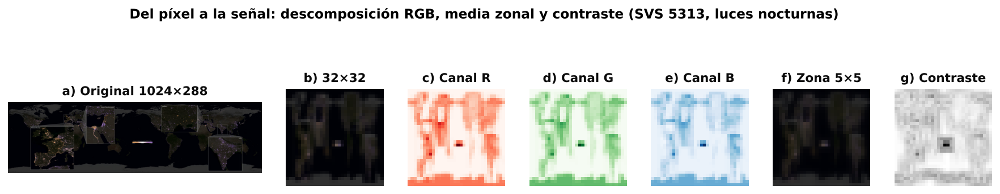

*Figura 1. Las luces nocturnas (SVS 5313) en cada etapa: (a) original, (b) cuadrícula 32 × 32, (c–e) canales rojo, verde y azul, (f) color después de escuchar a los vecinos y (g) contraste local.*

### 7.1 Abrir la imagen

> [!TIP]
> **Para niños:** la computadora entiende muchos tipos de fotos. Si no conoce alguno, se lo pide a un ayudante en internet (la API) que se lo traduce.

* Los **formatos web** (JPG, PNG, WebP, GIF, AVIF…) se abren directamente en el navegador.
* Los **formatos científicos o de cámara** se envían a `POST /api/visor/archivo` o `GET /api/visor/imagen`. `LectorImagen` (`api/visor/imagenes.py`) los reconoce por su extensión y por sus primeros bytes:
  * **RAW** (DNG, CR2, NEF, ARW… 22 tipos) con `rawpy`, usando el balance de blancos de la cámara.
  * **FITS** con `astropy` [36], tomando el primer plano de imagen válido.
  * **GeoTIFF y JPEG 2000** con `rasterio`. Respeta las bandas R, G, B y alfa, las paletas indexadas y, si hay sistema de coordenadas, calcula las **cuatro esquinas en WGS84** para ubicar la imagen en el mapa.
  * Los datos de 16 bits o decimales se ajustan con los **percentiles 2 y 98** de cada banda, para que unos pocos puntos extremos no apaguen el resto.
* Todo sale como **PNG RGBA** de máximo 1 600 px de lado. Los límites son 40 MiB por imagen y 90 millones de píxeles.
* **Video**: se toman hasta **120 fotogramas** (6 por segundo) de un tramo de hasta **60 s**. Si el navegador no puede abrirlo, `LectorVideo` (PyAV) lo recorta y lo pasa a H.264.

### 7.2 Partir en cuadritos

> [!TIP]
> **Para niños:** más cuadritos dan más detalle y la canción va más rápido. Menos cuadritos dan notas más largas.

`LectorMedios.muestrear()` dibuja la imagen en un lienzo de *N × N* y lee sus colores. La imagen **se estira hasta volverse cuadrada**, porque la curva de Hilbert necesita un cuadrado cuyo lado sea potencia de dos. Cada cuadrito suena el mismo tiempo:

$$\Delta t = \frac{T}{N^2}, \qquad T = \frac{\mathrm{duracion}}{\mathrm{velocidad}}$$

Con 24 s y 32 × 32, cada cuadrito dura **23,4 ms**. Con 128 × 128 dura **1,46 ms**.

### 7.3 Decidir qué cuadritos suenan

> [!TIP]
> **Para niños:** si la imagen tiene un fondo vacío, ese fondo no debe hacer ruido. Los cuadritos del fondo se quedan en silencio.

`MascaraMedio` (`mascara.js`) tiene tres modos:

1. **Transparencia original**: un cuadrito transparente (alfa 0) no suena.
2. **Quitar fondo uniforme**: mira los bordes, busca el color que más se repite (más de la mitad del borde) y lo borra **solo si está conectado con el borde**, como un balde de pintura que entra desde afuera. Así no borra zonas del mismo color que estén adentro.
3. **Solo área seleccionada**: tú dibujas un polígono de al menos 3 puntos y solo suena lo de adentro.

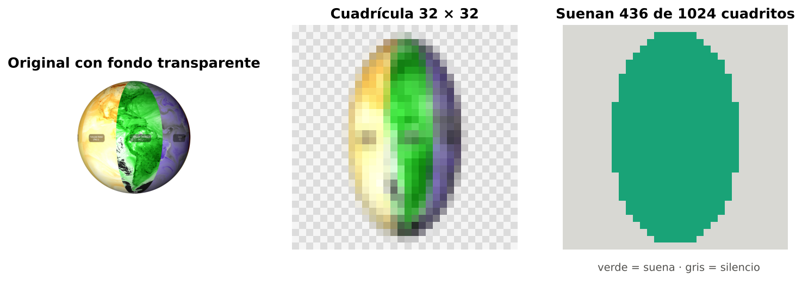

*Figura 2. La esfera de calidad del aire (SVS 5533) tiene fondo transparente: solo suenan 436 de 1 024 cuadritos (42,6 %). La cuadrícula también muestra que la imagen se estira hasta volverse cuadrada.*

### 7.4 Elegir el orden de lectura

> [!TIP]
> **Para niños:** es como leer un libro. Puedes leer renglón por renglón, ir y volver como una serpiente, dar vueltas desde el centro o seguir un laberinto que nunca da saltos grandes (Hilbert).

`coordenadasRecorrido(lado, recorrido)` devuelve el orden de las *N²* celdas. Las pruebas exigen que **cada celda aparezca una sola vez**.

| Recorrido | Cómo se construye | Propiedad |
| --- | --- | --- |
| Líneas por filas | De izquierda a derecha y de arriba abajo [6] | Salta de un borde al otro al cambiar de fila |
| Serpentina | Filas que alternan el sentido | Siempre pasa a un vecino |
| **Curva de Hilbert** | Se divide en cuadrantes que se rotan y reflejan [12] | La que mejor mantiene juntos los puntos cercanos [11] |
| Radial | Por distancia al centro y luego por ángulo | Del centro hacia afuera, como algunas piezas de Chandra [10] |
| Zigzag diagonal | Por diagonales alternas, como en JPEG | Pasos en diagonal |

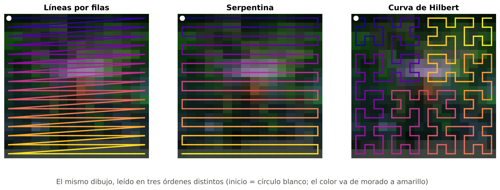

*Figura 3. Tres caminos del lápiz sobre la imagen de aerosoles (16 × 16).*


*Figura 4. Los cinco recorridos, con su paso medio y el porcentaje de pasos a un vecino directo.*

### 7.5 Escuchar a los vecinos y medir el contraste

> [!TIP]
> **Para niños:** si un cuadrito es muy distinto a sus vecinos, hay **contraste**, y la guitarra toca más rápido. Si todos se parecen, la guitarra toca tranquila.

Cada cuadrito mezcla su color con el de su vecindario de lado *k* ∈ {1, 3, 5, 7, 9, 15, 21} (por defecto 5):

$$\mathbf{c}_{\mathrm{sonoro}} = 0{,}7 \cdot \mathbf{c}_{\mathrm{propio}} + 0{,}3 \cdot \overline{\mathbf{c}}_{\mathrm{vecinos}}$$

El brillo da más peso al verde, que es el color al que el ojo es más sensible:

$$Y = \frac{R + 2G + B}{4}$$

El contraste combina cuánto varía el brillo en la zona (σ) y cuánto se diferencia el cuadrito de sus vecinos:

$$\kappa = \min\left(255,\ 0{,}66 \cdot \sigma_Y + 0{,}34 \cdot \left| Y_{\mathrm{propio}} - \overline{Y}_{\mathrm{vecinos}} \right| \right)$$

Para que sea rápido con zonas grandes, `MediaZonal` usa **tablas de áreas sumadas** [13], [14]: cada promedio se calcula con 4 lecturas, sin importar el tamaño de la zona. Todo el análisis crece en proporción al número de cuadritos.

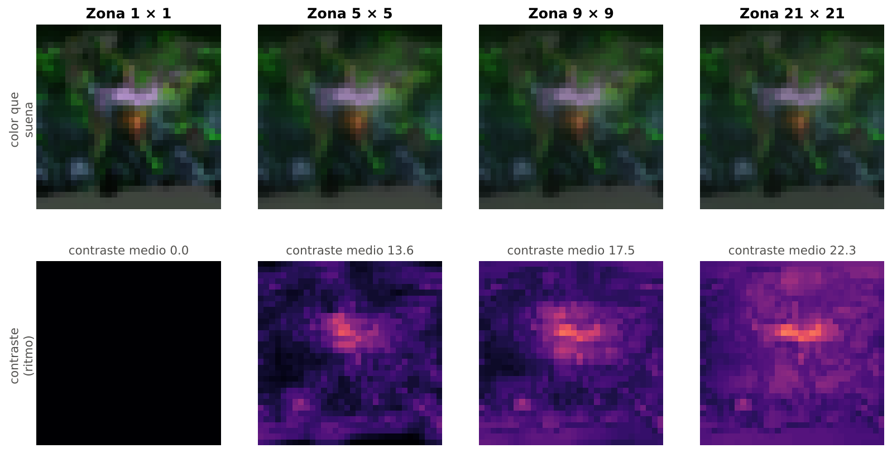

*Figura 5. Con zonas más grandes el color se suaviza (arriba) y el contraste, que guía el ritmo, se vuelve más amplio (abajo).*

### 7.6 Pasar el color a frecuencia

> [!TIP]
> **Para niños:** cuanto más fuerte es un color, más aguda suena su nota. El cero es silencio.

Cada canal tiene su banda de frecuencias:

| Canal | Clave | Banda | Extensión | Cambio por cada nivel |
| --- | --- | --- | --- | --- |
| 🔴 R | Fa | 20 – 250 Hz | 43,7 semitonos | 0,17 semitonos |
| 🟢 G | Sol | 350 – 500 Hz | 6,2 semitonos | 0,024 semitonos (≈ 2,4 cents) |
| 🔵 B | Sol | 600 – 20 000 Hz | 60,7 semitonos | 0,24 semitonos |

Para un nivel *v* entre 1 y 255 (el 0 es silencio), la escala **logarítmica**, que viene por defecto, es:

$$f(v) = f_{\min} \cdot \left(\frac{f_{\max}}{f_{\min}}\right)^{(v-1)/254}$$

y la **lineal**:

$$f(v) = f_{\min} + \left(f_{\max} - f_{\min}\right) \cdot \frac{v-1}{254}$$

La escala logarítmica hace que pasos iguales de color suenen como intervalos musicales iguales, que es como percibimos la altura [15]. Además, “más intenso = más agudo” es la dirección que la mayoría de las personas espera [16]. La nota MIDI se obtiene así:

$$m = \mathrm{redondear}\left(69 + 12 \cdot \log_2 \frac{f}{440}\right)$$

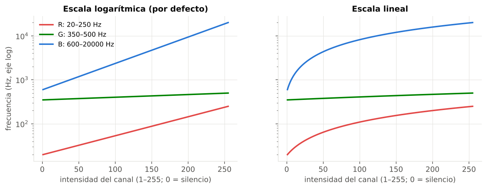

*Figura 6. Curvas de intensidad a frecuencia de las tres bandas.*

### 7.7 Componer la canción (`ArregloMusical`)

> [!TIP]
> **Para niños:** la computadora actúa como un profesor de guitarra. Mira el color de cada parte de la imagen y escoge un acorde. Si hay mucho contraste toca más notas. Al final busca dónde poner los dedos para que sea fácil de tocar.

Hay dos modos:

* **Modo píxeles RGB** (`sintesis-rgb.js`): tres osciladores cuya frecuencia cambia cuadrito a cuadrito. Es la sonificación pura.
* **Modo arreglo** (por defecto): convierte la misma lectura en música tocable.

Así funciona el modo arreglo:

1. **Tiempo musical.** A 68 negras por minuto en 4/4, 24 s dan **7 compases** (24,706 s).
2. **Acorde según el color.** Cada medio compás se resume en un color medio que elige un acorde de la tonalidad:
   * 🔴 si domina el rojo: **V** o **IV**;
   * 🔵 si domina el azul: **ii** o **iii**;
   * 🟢 si domina el verde: **I** o **vi**;
   * si no domina ninguno, el brillo recorre **I → ii → V → IV**.

   Hay 12 tónicas y modo mayor o menor.
3. **Ritmo según el contraste.** Si la textura de un pulso pasa de 18 en tiempo fuerte (10 en tiempo débil), el pulso se divide en dos. Si pasa de 28, en nivel intermedio, se divide en tres. También hay ritmos fijos.
4. **Alturas.** Solo se usan notas del acorde. La melodía se reparte entre los percentiles 10 y 88 de la propia imagen, para que una imagen oscura también use todo el diapasón. Los saltos tienen límite: 5 semitonos en nivel inicial y de 7 a 12 en intermedio.
5. **Papel de cada guitarra.** 🔴 R hace los **bajos**, 🟢 G **alterna pulgar y melodía** y 🔵 B toca las **notas agudas**.
6. **Digitación.** Se buscan todas las posiciones posibles (cuerda, traste), con traste ≤ 5 en inicial y ≤ 7 en intermedio, y se elige la más cómoda:

   $$\mathrm{costo} = 0{,}18 \cdot \mathrm{traste} + 0{,}45 \cdot \left|\Delta \mathrm{traste}\right| + 0{,}36 \cdot \left|\Delta \mathrm{cuerda}\right|$$

   Hay cinco afinaciones: guitarra estándar, requinto, tiple requinto en Do y en Si♭, y bajo de cuatro cuerdas.
7. **Dinámica.** Cada nota recibe una fuerza de max(0,12; (*I*/255)^0,63). Cada compás se marca *p*, *mp*, *mf* o *f*.
8. **Voz opcional.** Una cuarta parte cantada entre La3 y Do5, con una letra compuesta a partir del tema de la imagen.

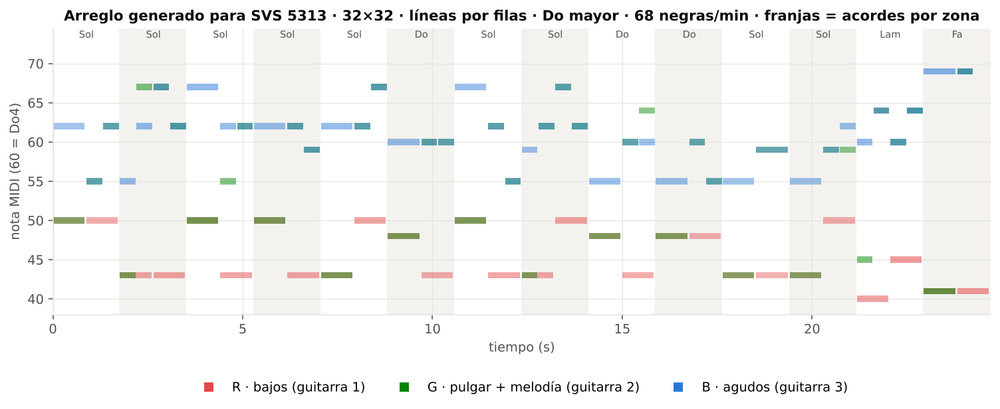

*Figura 7. Canción generada para SVS 5313. Cada barra es una nota y su transparencia indica la fuerza. Arriba aparece el acorde elegido para cada zona.*

### 7.8 Sonar y mezclar

> [!TIP]
> **Para niños:** si el color está a la izquierda de la imagen, el sonido sale más por el parlante izquierdo. Si está en el borde, suena con más eco, como en una cueva.

* 🎸 **Guitarras grabadas de verdad** (nailon, acero, eléctrica) y piano, con licencia CC0. Para cada nota se toma la grabación más cercana y se afina con `Tone.intervalToFrequencyRatio`.
* 🌊 **Volumen que sigue al color**: mientras la nota suena, su volumen cambia según la intensidad de la banda.
* 🎧 **Espacio**:
  * panorama = pan de la pista + (2*x* − 1) · 65 %;
  * eco = reverb · (0,08 + 0,92 · distancia al centro);
  * filtro opcional según la altura en la imagen: corte = 600 + 10 500 · (1 − *y*)² Hz.
* ⚙️ La mezcla se calcula en un **Web Worker** a 48 kHz en estéreo, sin congelar la página.

---

## 8. 🖥️ Cómo está hecho el frontend

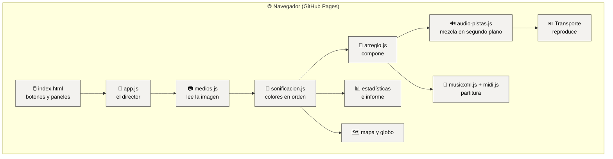

| Caja | En palabras sencillas | Archivos y clases |
| --- | --- | --- |
| 🖱️ **index.html** | La cara de la página: botones, listas y paneles. | `index.html`, `web/css/*.css` |
| 🧠 **app.js** | El director de orquesta: cuando cambias algo, avisa a los demás. | `AplicacionVisor` (700 líneas) |
| 📷 **medios.js** | Abre la imagen o el video y la corta en cuadritos. | `LectorMedios`, `mascara.js` |
| 🔢 **sonificacion.js** | Pone los colores en fila según el camino del lápiz. | `SecuenciaSonora`, `recorridos.js`, `estadistica-zonal.js` |
| 🎼 **arreglo.js** | El compositor: acordes, ritmo y dedos. | `ArregloMusical` (385 líneas) |
| 🔊 **audio-pistas.js** | Prepara el sonido sin trabar la página. | `renderizarArreglo`, `audio-worker.js`, `muestras.js`, `sintesis-rgb.js` |
| ⏯️ **Transporte** | El botón de play: arranca, pausa y mueve el cursor. | `Transporte` (Web Audio) |
| 📄 **Partitura** | Escribe la partitura y el archivo MIDI. | `musicxml.js`, `partitura-musical.js` (OpenSheetMusicDisplay), `midi.js` |
| 📊 **Estadísticas** | Cuenta colores y señala los puntos más interesantes. | `estadisticas.js`, `paneles.js`, `informe.js` ||

**Detalles importantes**

* ⏱️ **Sin cortes ni clics.** `Transporte` guarda un audio por modo y solo rehace lo que cambió. Al pausar baja el volumen en 8 ms y sincroniza el cursor con el reloj de audio.
* 📊 **Firmas RGB.** `calcularInforme()` agrupa cada color en 4, 8 o 16 niveles por canal. Con eso calcula qué combinaciones se repiten, estadísticas por canal (mínimo, máximo, media, mediana, desviación, P5 y P95), histogramas y los **píxeles destacados**: el máximo de cada canal, el más brillante, el mayor cambio entre vecinos en el camino y la primera aparición del color más frecuente.
* 🤖 **IA local opcional.** Para la letra se usa MobileNet V1 cuantizado a 8 bits (493 488 bytes), que corre en el propio navegador dentro de un Worker. La imagen no sale del equipo.

---

## 9. ⚙️ Cómo está hecho el backend

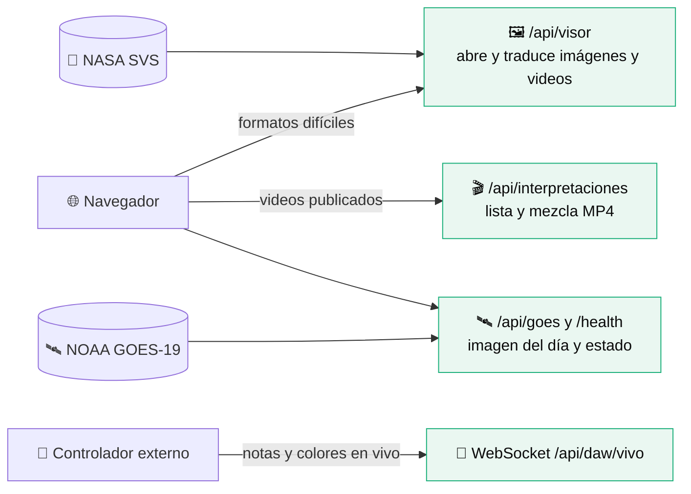

| Caja | En palabras sencillas | Detalle técnico |
| --- | --- | --- |
| 🖼️ **/api/visor** | Un traductor: abre fotos de cámara, de telescopio o con coordenadas, y videos raros. | `importar`, `imagen`, `video` (con `Range`), `archivo`. Usa Pillow, pillow‑heif, rasterio, rawpy, astropy y PyAV |
| 🎬 **/api/interpretaciones** | Une un video con tres grabaciones (rojo, verde y azul). | FFmpeg `amix` + `alimiter`, H.264 + AAC, hasta 5 minutos y 4K |
| 📡 **WebSocket** | Un canal para que otros aparatos envíen notas o colores en vivo. | Mensajes `note` y `rgb` validados con Pydantic, máximo 45 por segundo |
| 🛰️ **/api/goes** | Entrega la foto satelital del día sobre Colombia. | GeoColor GOES‑19, sector norte de Suramérica; se renueva cada 10 min |

### Endpoints

| Método | Ruta | Uso |
| --- | --- | --- |
| GET | `/health` | Estado y versión |
| GET | `/api/goes` · `/api/datos` | Imagen GOES‑19 del día · datos de la rocola |
| GET | `/api/visor/importar?url=` | Lee una página de NASA SVS y arma un paquete con sus medios |
| GET | `/api/visor/imagen?url=` | Descarga y normaliza una imagen remota a PNG |
| GET | `/api/visor/video?url=&convertir=&inicio=` | Transmite un video o lo recorta (≤ 60 s) |
| POST | `/api/visor/archivo` | Normaliza un archivo subido (imágenes hasta 40 MiB, videos hasta 80 MiB) |
| GET · POST | `/api/interpretaciones/{carpeta}` · `/api/interpretaciones/mezclar` | Lista los MP4 de un paquete · mezcla un video con tres audios |
| WS | `/api/daw/vivo/{sesion}` | Sala de eventos en vivo |

### 🛡️ Seguridad

* **Solo internet público.** Antes de descargar algo se revisa que la dirección sea pública, para que nadie use la API contra redes internas (protección SSRF). Se conecta a la IP ya revisada y se vuelve a revisar en cada redirección, hasta un máximo de 6.
* **Límites de tamaño** comprobados mientras se descarga, en bloques de 64 KiB.
* **WebSocket con límites**: máximo 200 salas, 12 personas por sala, mensajes de hasta 1 000 bytes y 45 por segundo.
* **FFmpeg encerrado**: solo lee archivos locales, procesa una mezcla a la vez y se detiene a los 210 s.
* Cabecera `nosniff`, compresión GZip y CORS configurable con `CORS_ORIGINS`.

### Estructura del repositorio

```text
Orbita_Sonora/
├── index.html · main.py · package.json
├── api/            🐍 FastAPI: rutas/ y visor/ (imágenes, videos, red segura, catálogo)
├── web/
│   ├── js/         🧠 recorridos.js, estadisticas.js y 28 módulos en visor/
│   ├── css/        🎨 5 hojas de estilo
│   ├── muestras/   🎸 guitarras y piano CC0
│   ├── modelo/     🤖 MobileNet int8
│   ├── geo/        🗺️ teselas Blue Marble y GeoJSON
│   ├── vendor/     📦 Tone.js, @tonejs/midi, OpenSheetMusicDisplay, MapLibre
│   └── fonts/      🔤 DM Sans y Space Grotesk
├── datos/          🚀 9 paquetes NASA SVS (manifiesto, portada y original)
├── videos/         🎬 interpretaciones MP4
├── scripts/        🛠️ servir, abrir_local, actualizar_catalogo, preparar_github…
├── pruebas/        ✅ sonificacion.mjs y verificar.py
└── docs/           📘 logos, huellas SHA-256 e informe (figuras, datos y scripts)
```

| Capa | Tecnología (versión incluida) |
| --- | --- |
| Interfaz | HTML5, CSS y módulos ES nativos, sin empaquetador |
| Audio | Web Audio API [18] · **Tone.js 15.1.22** [17] |
| Partitura y MIDI | **OpenSheetMusicDisplay 1.9.8** · **@tonejs/midi 2.0.28** |
| Mapas | **MapLibre GL JS 5.6.0** y globo propio en canvas |
| API | **FastAPI** ≥ 0.115 · Uvicorn · httpx · lxml |
| Imágenes y video | Pillow · pillow‑heif · rasterio · rawpy · astropy · PyAV · imageio‑ffmpeg |

---

## 10. 📈 Resultados medidos

### 10.1 Cómo se midió

Las cifras salen de **ejecutar los propios módulos del proyecto** (`sonificacion.js`, `arreglo.js`, `audio-pistas.js`, `estadisticas.js` y `musicxml.js`) en **Node.js 22** sobre las 9 imágenes del catálogo, con los ajustes que trae la web: 32 × 32, zona 5 × 5, 24 s, escala logarítmica, Do mayor, 68 negras por minuto, 4/4, ritmo según el contraste, nivel intermedio y tres guitarras de nailon.

* El paso a cuadrícula se hizo con Pillow (bilineal), como aproximación al `drawImage` del navegador.
* El audio usó los **timbres sintéticos de respaldo**, porque Node no decodifica los MP3. Las notas son idénticas a las del navegador.
* Los tiempos son la mediana de 15 ejecuciones para el análisis y la composición, y de 3 para el audio, en un contenedor Linux. Son orientativos.

Los scripts y los datos crudos están en [`docs/informe/reproducir/`](docs/informe/reproducir/) y [`docs/informe/resultados.json`](docs/informe/resultados.json).


*Figura 8. Las nueve imágenes evaluadas [34].*

### 10.2 Resultados por imagen

| SVS | Tema | Cuadritos que suenan | Notas R / G / B | Total | Acordes distintos | Firmas (8 niveles) | Firma más común | Contraste medio |
| --- | --- | ---: | ---: | ---: | ---: | ---: | ---: | ---: |
| 40467 | Tierra desde el espacio | 1024 | 28 / 53 / 54 | 135 | 3 | 36 | 19,5 % | 12,2 |
| 5313 | Luces nocturnas | 1024 | 28 / 43 / 43 | 114 | 4 | 10 | 71,8 % | 10,3 |
| 3912 | Corrientes oceánicas | 1024 | 28 / 40 / 39 | 107 | 5 | 28 | 37,7 % | 8,3 |
| 5669 | Aerosoles GEOS | 1024 | 28 / 50 / 50 | 128 | 4 | 46 | 19,5 % | 13,6 |
| 5533 | Calidad del aire | **436** | 26 / 50 / 50 | 126 | 4 | **86** | 13,8 % | 16,9 |
| 5425 | Perpetual Ocean 2 | 1024 | 27 / 54 / 54 | 135 | 2 | 41 | 13,6 % | 17,0 |
| 5011 | Relámpagos desde la ISS | 1024 | 28 / 44 / 44 | 116 | 4 | 16 | 36,8 % | 9,7 |
| 4960 | Río atmosférico | 1024 | 28 / 47 / 47 | 122 | 5 | 32 | 63,2 % | 11,2 |
| 4950 | Altura de bosques GEDI | 1024 | 27 / 51 / 50 | 128 | 5 | 32 | 17,2 % | 13,3 |

* 🎼 Todas producen **7 compases (24,706 s)** y entre **107 y 135 notas** (media 123,4).
* ✅ El **100 %** de las notas pertenece al acorde de su zona y **ninguna pasa del traste 7**.
* 🔴 La pista roja es la más estable (26–28 notas, cerca de una por pulso); la verde y la azul concentran el ritmo.
* 🌐 La esfera 5533 solo hace sonar el 42,6 % de los cuadritos, pero es la de más variedad de color (86 firmas).
* 🌑 Las imágenes oscuras y parejas (5313, 4960) tienen una firma dominante del 63–72 %, menos acordes y casi todos sus compases en *p*.

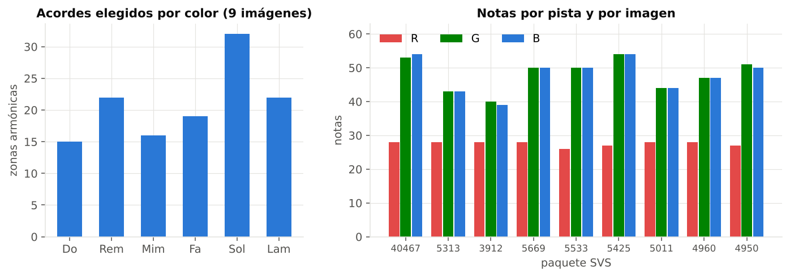

*Figura 9. Izquierda: acordes elegidos en 126 zonas; Sol (V) es el más frecuente (25,4 %). Derecha: notas por pista.*

### 10.3 El orden de lectura cambia la música

Se midió, sobre las 9 imágenes: el paso medio del lápiz, el **salto de brillo** |Δ*Y*| entre cuadritos seguidos, la **autocorrelación** ρ(1) (qué tanto se parece un cuadrito al siguiente), el salto melódico y el número de notas de la guitarra verde.

| Recorrido | Paso medio | Pasos a un vecino | \|Δ*Y*\| (media ± DE) | ρ(1) | Salto melódico (semitonos) | Notas G |
| --- | ---: | ---: | ---: | ---: | ---: | ---: |
| Líneas por filas | 1,91 | 97,0 % | 9,28 ± 2,56 | 0,885 | 11,40 | 48,0 |
| Serpentina | 1,00 | 100 % | 8,80 ± 2,66 | **0,902** | 11,24 | 47,1 |
| **Curva de Hilbert** | 1,00 | 100 % | **7,85 ± 1,81** | 0,901 | 10,72 | **41,7** |
| Radial | 7,77 | 4,7 % | 21,59 ± 5,01 | 0,526 | **9,57** | 50,2 |
| Zigzag diagonal | 1,39 | 6,1 % (el resto en diagonal) | 10,87 ± 2,37 | 0,838 | 10,52 | 47,9 |


*Figura 10. Suavidad (izquierda) y coherencia (derecha) de cada recorrido.*

* 🧩 **Hilbert es el más suave**: su salto de brillo es un **15,4 % menor** que el de filas, y es el que menos varía entre imágenes. Esto coincide con la teoría de curvas de llenado [11]. Como hay menos contraste entre pasos, la guitarra verde toca un **13 % menos de notas** y sostiene más cada nota.
* 🌀 **Radial es el más inquieto**: da pasos largos (7,8 cuadritos de media) y ρ(1) baja a 0,53. Su salto melódico es el menor porque el arreglo limita los saltos; la inquietud pasa al ritmo.

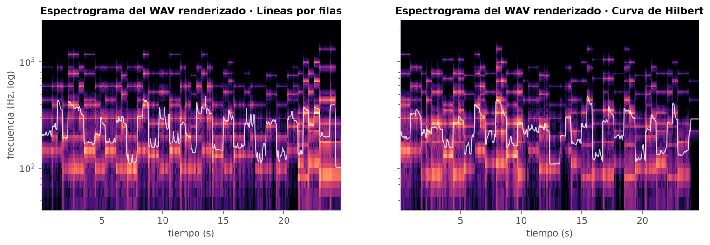

*Figura 11. Espectrogramas del audio de SVS 5313 leído por filas y con Hilbert. La línea blanca es el centroide espectral, el “centro de gravedad” del sonido. Los acordes son los mismos; cambian el orden y la cantidad de ataques.*

### 10.4 La zona sonora controla el ritmo

| Zona | 1 × 1 | 3 × 3 | 5 × 5 | 7 × 7 | 9 × 9 | 15 × 15 | 21 × 21 |
| --- | ---: | ---: | ---: | ---: | ---: | ---: | ---: |
| Contraste medio | 0,0 | 8,3 | 12,5 | 15,5 | 17,9 | 23,6 | 27,6 |
| Notas totales | 96,6 | 116,8 | 123,4 | 127,9 | 131,0 | 133,2 | 134,0 |
| Pulsos divididos (G) | 38,0 % | 75,6 % | 84,7 % | 89,9 % | 92,5 % | 96,2 % | 96,9 % |

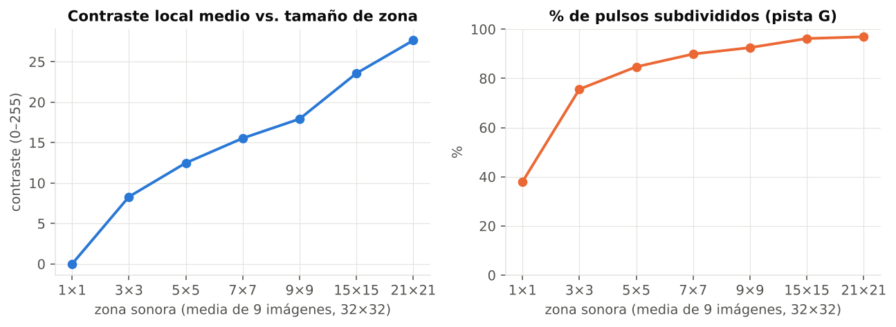

*Figura 12. Al pasar de 1 × 1 a 5 × 5 aparecen un 27,7 % más de notas. Desde 9 × 9 el efecto casi se estabiliza.*

### 10.5 Velocidad

| Cuadrícula | Cuadritos | Duración de cada uno | Análisis | Composición | Audio de 24,7 s |
| --- | ---: | ---: | ---: | ---: | ---: |
| 8 × 8 | 64 | 375 ms | 0,08 ms | 0,40 ms | 175 ms |
| 16 × 16 | 256 | 93,8 ms | 0,34 ms | 0,59 ms | 171 ms |
| 32 × 32 | 1 024 | 23,4 ms | 0,92 ms | 1,09 ms | 248 ms |
| 64 × 64 | 4 096 | 5,9 ms | 3,63 ms | 2,86 ms | 243 ms |
| 128 × 128 | 16 384 | 1,5 ms | 13,72 ms | 10,16 ms | 224 ms |


*Figura 13. El análisis crece en proporción a los cuadritos (256 veces más cuadritos, unas 170 veces más tiempo). El audio depende de la duración, no de la cuadrícula, y se genera de 80 a 150 veces más rápido que el tiempo real.*

### 10.6 Pruebas automáticas

✅ `node pruebas/sonificacion.mjs` **pasa** en esta versión. Comprueba, entre otras cosas:

* que los cinco recorridos visiten cada cuadrito una vez y que Hilbert sea continuo de 8 a 128;
* que las tablas de frecuencia sean crecientes y tengan los extremos exactos;
* el caso exacto 70/30: una celda (100, 50, 20) rodeada de negro da (70, 35, 14);
* trastes ≤ 7 (≤ 5 en inicial) en **12 tónicas × 2 modos × 4 afinaciones**;
* que cada nota esté en su acorde y que cada compás sume su duración exacta;
* que cambiar el recorrido, la zona o la escala cambie el audio;
* el GeoJSON y que la ocupación de firmas sume 100 %.

`python pruebas/verificar.py` prueba la API. Necesita `requirements-dev.txt` y no se ejecutó en el entorno donde se preparó este informe.

---

## 11. ⚖️ Comparación con otras herramientas

| Funcionalidad | **Órbita Sonora** | Chandra *Universe of Sound* [9], [10] | The vOICe [7] | Photosounder [32] / Virtual ANS [33] | TwoTone [31] | Highcharts Sonification Studio [27] | STRAUSS / Astronify / SonoUno [28]–[30] |
| --- | :---: | :---: | :---: | :---: | :---: | :---: | :---: |
| Entrada | Imagen, video, URL NASA, RAW, FITS, GeoTIFF | Imágenes curadas | Cámara o imagen | Imagen como espectrograma | Tabla | Tabla | Series y espectros |
| El usuario controla el mapeo | ✅ total | ❌ | ◐ | ✅ | ✅ | ✅ | ✅ con código |
| Recorridos de lectura | ✅ 5 | ◐ según la pieza | ◐ columnas | ◐ eje fijo | ◐ | ◐ | ◐ |
| Una voz por banda de color | ✅ | ◐ | ❌ | ❌ | — | — | — |
| Acordes y digitación tocable | ✅ | ◐ compuesto a mano | ❌ | ❌ | ◐ escalas | ❌ | ❌ |
| Partitura MusicXML con tablatura | ✅ | ❌ | ❌ | ❌ | ❌ | ❌ | ❌ |
| MIDI | ✅ | ❌ | ❌ | ◐ entrada (Virtual ANS) | ◐ beta | — | ◐ |
| Mapa y GeoJSON | ✅ | ❌ | ❌ | ❌ | ❌ | ❌ | ❌ |
| Estadística de la imagen | ✅ | ❌ | ❌ | ◐ espectral | ◐ | ◐ | ✅ |
| Funciona en el navegador | ✅ | ✅ (videos) | ◐ | ❌ | ✅ | ✅ | ◐ SonoUno web |
| Licencia | Apache‑2.0 | Contenido NASA | Ver sitio del autor | Comercial / gratuita | Abierta | Gratuita; comercial con licencia | Abiertas |

✅ sí · ◐ parcial · ❌ no · — no aplica

Órbita Sonora queda en un punto intermedio:

* es **más controlable** que una sonificación curada como las de Chandra;
* es **más musical** que un sonificador científico como Astronify;
* está **más ligada a la imagen** que los sonificadores de tablas como TwoTone o Highcharts.

Ninguna de las herramientas revisadas reúne en un solo lugar **bandas RGB + partitura para guitarra con tablatura + mapa**.

---

## 12. 💬 Discusión

**Fidelidad frente a música.** El modo píxeles RGB conserva la señal: cada nivel de color es una frecuencia distinta. El modo arreglo la simplifica, porque usa solo notas del acorde y limita los saltos. Aun así **conserva información de la imagen**: el número de notas, los acordes y la dinámica cambian entre imágenes y recorridos, y el audio cambia con cada ajuste. A diferencia del sistema de Meijer [7], no se puede reconstruir la imagen a partir del sonido. Es una sonificación para **comprender y crear**, no para leer valores exactos.

**Las bandas no son iguales.** La banda verde solo abarca 6,2 semitonos, así que un nivel de color equivale a unos 2,4 cents, un cambio difícil de oír. Las bandas roja y azul tienen entre 7 y 10 veces más resolución. En el modo arreglo esto se compensa al repartir la melodía según cada imagen, pero en el modo píxeles el verde varía poco. Además, la banda azul llega a 20 kHz, que muchos adultos ya no oyen.

**El orden importa.** Hilbert reduce los saltos de brillo y da música con menos ataques. Las filas meten 31 saltos largos por imagen, uno por fila. El radial mezcla zonas lejanas. Esto deja una lección clara: **el mismo dato, ordenado distinto, suena distinto**.

**Limitaciones**

1. 👂 **Falta probar con personas.** Las revisiones del campo lo piden [3], [8] y el estudio de Arcand et al. [9] es un buen modelo.
2. 🔲 **La imagen se estira a un cuadrado** (figura 2). En 5313 (1024 × 288) el estiramiento es de 3,6 veces, y al reducir mucho se puede perder detalle fino.
3. 💡 **El brillo es una aproximación.** (R + 2G + B)/4 no es la luminancia colorimétrica y no se corrige la curva sRGB.
4. 📡 **El WebSocket existe en la API**, pero la web todavía no lo usa.
5. ☁️ **Los formatos científicos y los videos dependen del servidor.** Si la API está dormida, esas funciones esperan; el resto de la web sigue funcionando.
6. ⏱️ **Los tiempos se midieron en un solo equipo** y con timbres sintéticos.

**Próximos pasos**

* Pruebas con estudiantes y con personas ciegas o con baja visión.
* Modo de **sondeo**: tocar una zona y oírla [4].
* Usar canales satelitales individuales en lugar del RGB combinado.
* Ampliar la banda verde.
* Usar luminancia perceptual.

---

## 13. ✅ Conclusiones

1. Órbita Sonora implementa una cadena completa y reproducible: **imagen → bandas RGB → recorrido → zona 70/30 → frecuencia → canción → audio y partitura**. Son unas 5 060 líneas de JavaScript y 1 120 de Python, y funciona sin instalar nada.
2. En las 9 imágenes generó canciones de **7 compases y 107–135 notas**. El **100 %** de las notas respeta la armonía y **ninguna supera el traste 7**: son partituras tocables.
3. **El orden de lectura se puede medir y se oye.** Hilbert reduce un **15,4 %** el salto de brillo y un **13 %** las notas de la melodía frente a las filas. El radial casi duplica la variación (|Δ*Y*| = 21,6; ρ(1) = 0,53).
4. **La zona sonora regula el ritmo.** De 1 × 1 a 21 × 21, los pulsos divididos pasan del **38 % al 97 %**.
5. **Es rápida.** Análisis y composición tardan **≈ 2 ms** en 32 × 32 y **≈ 24 ms** en 128 × 128; el audio de 24,7 s está listo en **0,17–0,30 s**.
6. **Lo que la hace distinta** es unir análisis RGB, partitura con tablatura (MusicXML/MIDI) y mapa en una web abierta. **Lo que falta**: evaluar con oyentes y equilibrar la banda verde.

---

## 14. 🛠️ Instalar, probar y publicar

**Solo la web**

```bash
python3 scripts/abrir_local.py          # abre http://127.0.0.1:8000/
```

**Web + API**

```bash
python -m venv .venv && source .venv/bin/activate   # Windows: .venv\Scripts\activate
pip install -r requirements-dev.txt
python -m scripts.servir                             # http://127.0.0.1:8000/  ·  /docs = API
```

**Pruebas**

```bash
node pruebas/sonificacion.mjs
python pruebas/verificar.py
```

**Repetir las mediciones y figuras de este informe** (Node ≥ 18 y Python con Pillow, NumPy, SciPy y Matplotlib)

```bash
cd docs/informe/reproducir
python3 prep.py ../../..             # cuadrículas de las 9 imágenes
node experimento.mjs ../../..        # métricas → resultados.json
node notas5669.mjs ../../..          # datos de las figuras ilustrativas
python3 figuras.py ../../..          # figuras de resultados
python3 figuras2.py ../../..         # banner, logos y figuras explicativas
```

**Catálogo**

```bash
python -m scripts.actualizar_catalogo --vistas   # después de editar datos/fuentes-svs.json
python -m scripts.indexar_videos                 # para MP4 con otro nombre que interpretacion.mp4
```

**Publicación**: `PUBLICAR_EN_GITHUB.bat` o `python3 scripts/preparar_github.py --publicar` para GitHub Pages. Render ejecuta `uvicorn main:app --host 0.0.0.0 --port $PORT`. Más detalles en [PUBLICAR.md](PUBLICAR.md), [ARQUITECTURA.md](ARQUITECTURA.md) y [LEER_PRIMERO.md](LEER_PRIMERO.md).

---

## 15. 🤝 Uso de inteligencia artificial y ética

> [!IMPORTANT]
> **Esta documentación se elaboró con ayuda de inteligencia artificial.** El texto de este README, el análisis cuantitativo, las figuras de `docs/informe/` y los scripts de `docs/informe/reproducir/` se prepararon con el asistente **Claude (Anthropic)**, a partir de la lectura del código fuente del repositorio y de la ejecución de sus propios módulos.

Para que el trabajo sea transparente y verificable:

* 🔍 **Trazabilidad.** Cada cifra del informe sale de ejecutar el código del proyecto, y los datos crudos están en `docs/informe/resultados.json`. Cualquier persona puede repetir las mediciones con los comandos de la sección 14.
* 📚 **Fuentes reales.** Las referencias se contrastaron con sus publicaciones y sitios oficiales. Si encuentras un error, abre un *issue*.
* 👥 **Responsabilidad humana.** El equipo de Orbidata Analytics y del Semillero de Astronomía ITM revisa y responde por lo publicado. La IA fue una herramienta de apoyo, no la autora del proyecto.
* 🖼️ **Respeto a los autores.** Las imágenes conservan sus créditos (NASA, NOAA) y las grabaciones y librerías mantienen sus licencias (sección 16).
* 🔒 **Privacidad.** La IA de la página (MobileNet para la letra) corre en el navegador: las fotos de los usuarios no se envían a ningún servicio de IA.
* 🎵 **Música generada por algoritmo.** Las canciones las produce un algoritmo determinista a partir de los datos. Si las publicas, indica que provienen de Órbita Sonora y de la imagen original.

Esta declaración se refiere a la documentación. El uso de herramientas de IA en el desarrollo del código, si lo hubo, lo declara el equipo por separado.

---

## 16. 📜 Licencias y créditos

| Componente | Licencia o condición | Dónde está |
| --- | --- | --- |
| Código de Órbita Sonora | **Apache License 2.0** | [LICENSE](LICENSE), [NOTICE](NOTICE) |
| Tone.js 15.1.22 · @tonejs/midi 2.0.28 | MIT | `web/vendor/` |
| OpenSheetMusicDisplay 1.9.8 · MapLibre GL JS 5.6.0 | BSD‑3‑Clause | `web/vendor/` |
| DM Sans · Space Grotesk | SIL Open Font License 1.1 | `web/fonts/` |
| MobileNet V1 (Keras Applications) | Apache 2.0 | `web/modelo/` · [FUENTE.md](web/modelo/FUENTE.md) |
| Guitarras de nailon y acero y piano (Meta Open Sound) · guitarra eléctrica (FreePats) | CC0 1.0 | `web/muestras/` · [FUENTES.md](web/muestras/FUENTES.md) |
| Visualizaciones NASA SVS | Créditos de NASA en cada `paquete.json`; huellas en `docs/ARCHIVOS_NASA_SHA256.txt` | `datos/paquetes/` |
| Imagen GeoColor GOES‑19 | NOAA / NESDIS / STAR | `web/geo/` |
| Mapa base Blue Marble Next Generation | NASA Earth Observatory (2004) | `web/geo/` |
| Geometrías terrestres | Natural Earth, dominio público | `web/geo/tierra.geojson` |
| Dependencias Python | Licencias permisivas de cada proyecto; FFmpeg, LibRaw y libheif tienen licencias propias (LGPL/GPL según la compilación) | `requirements.txt` |
| Logos | Originales del equipo | `docs/img/` · `docs/LOGOS_SHA256.txt` |

**Cómo citar**

> Orbidata Analytics y Semillero de Astronomía ITM, “Órbita Sonora: sonificación espectral de imágenes y arreglo musical en el navegador,” versión 5.8.0, 2026. [En línea]. Disponible: https://github.com/orbidataanalytics/Orbita_Sonora

---

## 17. 📖 Referencias (IEEE)

[1] T. Hermann, A. Hunt y J. G. Neuhoff, Eds., *The Sonification Handbook*. Berlín, Alemania: Logos, 2011.

[2] G. Kramer *et al.*, “Sonification report: Status of the field and research agenda,” International Community for Auditory Display (ICAD), Santa Fe, NM, EE. UU., 1999.

[3] G. Dubus y R. Bresin, “A systematic review of mapping strategies for the sonification of physical quantities,” *PLoS ONE*, vol. 8, no. 12, art. e82491, 2013, doi: 10.1371/journal.pone.0082491.

[4] W. S. Yeo y J. Berger, “A framework for designing image sonification methods,” en *Proc. 11th Int. Conf. Auditory Display (ICAD)*, Limerick, Irlanda, 2005.

[5] W. S. Yeo y J. Berger, “Application of image sonification methods to music,” en *Proc. Int. Computer Music Conf. (ICMC)*, Barcelona, España, 2005.

[6] W. S. Yeo y J. Berger, “Raster scanning: A new approach to image sonification, sound visualization, sound analysis and synthesis,” en *Proc. Int. Computer Music Conf. (ICMC)*, Nueva Orleans, LA, EE. UU., 2006, pp. 34–41.

[7] P. B. L. Meijer, “An experimental system for auditory image representations,” *IEEE Trans. Biomed. Eng.*, vol. 39, no. 2, pp. 112–121, feb. 1992, doi: 10.1109/10.121642.

[8] A. Zanella, C. M. Harrison, S. Lenzi, J. Cooke, P. Damsma y S. W. Fleming, “Sonification and sound design for astronomy research, education and public engagement,” *Nature Astronomy*, vol. 6, pp. 1241–1248, 2022, doi: 10.1038/s41550-022-01721-z.

[9] K. K. Arcand *et al.*, “A Universe of Sound: processing NASA data into sonifications to explore participant response,” *Frontiers in Communication*, vol. 9, art. 1288896, 2024, doi: 10.3389/fcomm.2024.1288896.

[10] NASA/CXC/SAO, K. Arcand y SYSTEM Sounds (M. Russo, A. Santaguida), “Jingle, Pluck, and Hum: Sounds from Space,” Chandra X‑ray Observatory, 16 sep. 2021. [En línea]. Disponible: https://chandra.si.edu/photo/2021/sonify4/

[11] B. Moon, H. V. Jagadish, C. Faloutsos y J. H. Saltz, “Analysis of the clustering properties of the Hilbert space-filling curve,” *IEEE Trans. Knowl. Data Eng.*, vol. 13, no. 1, pp. 124–141, 2001, doi: 10.1109/69.908985.

[12] D. Hilbert, “Ueber die stetige Abbildung einer Linie auf ein Flächenstück,” *Mathematische Annalen*, vol. 38, pp. 459–460, 1891.

[13] F. C. Crow, “Summed-area tables for texture mapping,” *Computer Graphics (Proc. SIGGRAPH ’84)*, vol. 18, no. 3, pp. 207–212, 1984, doi: 10.1145/800031.808600.

[14] P. Viola y M. Jones, “Rapid object detection using a boosted cascade of simple features,” en *Proc. IEEE Conf. Computer Vision and Pattern Recognition (CVPR)*, 2001, pp. I‑511–I‑518.

[15] S. S. Stevens, J. Volkmann y E. B. Newman, “A scale for the measurement of the psychological magnitude pitch,” *J. Acoust. Soc. Am.*, vol. 8, no. 3, pp. 185–190, 1937.

[16] B. N. Walker, “Magnitude estimation of conceptual data dimensions for use in sonification,” *J. Exp. Psychol.: Applied*, vol. 8, no. 4, pp. 211–221, 2002.

[17] Y. Mann, “Interactive music with Tone.js,” en *Proc. 1st Web Audio Conf. (WAC)*, IRCAM, París, Francia, 2015.

[18] W3C, “Web Audio API,” W3C Recommendation, jun. 2021. [En línea]. Disponible: https://www.w3.org/TR/webaudio/

[19] M. Good, “MusicXML for notation and analysis,” en *The Virtual Score: Representation, Retrieval, Restoration*, W. B. Hewlett y E. Selfridge-Field, Eds., *Computing in Musicology* 12. Cambridge, MA, EE. UU.: MIT Press, 2001, pp. 113–124.

[20] MIDI Manufacturers Association, *The Complete MIDI 1.0 Detailed Specification*. Los Ángeles, CA, EE. UU.: MMA, 1996.

[21] A. G. Howard *et al.*, “MobileNets: Efficient convolutional neural networks for mobile vision applications,” arXiv:1704.04861, 2017.

[22] B. Jacob *et al.*, “Quantization and training of neural networks for efficient integer-arithmetic-only inference,” en *Proc. IEEE/CVF Conf. Computer Vision and Pattern Recognition (CVPR)*, 2018, pp. 2704–2713.

[23] J. Deng, W. Dong, R. Socher, L.-J. Li, K. Li y L. Fei-Fei, “ImageNet: A large-scale hierarchical image database,” en *Proc. IEEE Conf. Computer Vision and Pattern Recognition (CVPR)*, 2009, pp. 248–255.

[24] S. D. Miller, D. T. Lindsey, C. J. Seaman y J. E. Solbrig, “GeoColor: A blending technique for satellite imagery,” *J. Atmos. Ocean. Technol.*, vol. 37, no. 3, pp. 429–448, 2020, doi: 10.1175/JTECH-D-19-0134.1.

[25] T. J. Schmit *et al.*, “A closer look at the ABI on the GOES-R series,” *Bull. Amer. Meteor. Soc.*, vol. 98, no. 4, pp. 681–698, 2017.

[26] M. O. Román *et al.*, “NASA’s Black Marble nighttime lights product suite,” *Remote Sens. Environ.*, vol. 210, pp. 113–143, 2018.

[27] S. J. Cantrell, B. N. Walker y Ø. Moseng, “Highcharts Sonification Studio: An online, open-source, extensible, and accessible data sonification tool,” en *Proc. 26th Int. Conf. Auditory Display (ICAD)*, 2021.

[28] J. W. Trayford y C. M. Harrison, “Introducing STRAUSS: A flexible sonification Python package,” en *Proc. 28th Int. Conf. Auditory Display (ICAD)*, Norrköping, Suecia, 2023, pp. 249–256, doi: 10.21785/icad2023.1978.

[29] J. Casado, G. de la Vega y B. García, “SonoUno development: a User-Centered Sonification software for data analysis,” *J. Open Source Softw.*, vol. 9, no. 93, art. 5819, 2024, doi: 10.21105/joss.05819.

[30] C. Brasseur, S. Fleming, J. Kotler y K. Meredith, “Astronify: v0.1,” Zenodo, 2023, doi: 10.5281/zenodo.7713214.

[31] Sonify y Datavized Technologies, “TwoTone: open-source web tool for generating music from data,” GitHub. [En línea]. Disponible: https://github.com/sonifydata/twotone

[32] M. Rouzic, “Photosounder,” software. [En línea]. Disponible: https://photosounder.com

[33] A. Zolotov, “Virtual ANS,” versión 3, software. [En línea]. Disponible: https://warmplace.ru/soft/ans/

[34] NASA Scientific Visualization Studio, visualizaciones 3912, 4950, 4960, 5011, 5313, 5425, 5533, 5669 y 40467. [En línea]. Disponible: https://svs.gsfc.nasa.gov/

[35] NOAA/NESDIS Center for Satellite Applications and Research, “GOES-19 ABI GeoColor.” [En línea]. Disponible: https://www.star.nesdis.noaa.gov/GOES/

[36] Astropy Collaboration *et al.*, “The Astropy Project: Sustaining and growing a community-oriented open-source project and the latest major release (v5.0) of the core package,” *Astrophys. J.*, vol. 935, no. 2, art. 167, 2022.

[37] J. Tucker Brown, C. M. Harrison, A. Zanella y J. Trayford, “Evaluating the efficacy of sonification for signal detection in univariate, evenly sampled light curves using astronify,” *Mon. Not. R. Astron. Soc.*, vol. 516, no. 4, pp. 5674–5683, 2022.

[38] S. Ramírez, “FastAPI,” software. [En línea]. Disponible: https://fastapi.tiangolo.com

[39] PhonicScore, “OpenSheetMusicDisplay,” software. [En línea]. Disponible: https://opensheetmusicdisplay.org

[40] MapLibre contributors, “MapLibre GL JS,” software. [En línea]. Disponible: https://maplibre.org

---

<div align="center">

<picture>
  <source media="(prefers-color-scheme: dark)" srcset="docs/informe/marca/logo-orbita-sonora-blanco.png">
  
</picture>

**Hecho con 🎸 y 🛰️ en Medellín, Colombia**
Orbidata Analytics · Semillero de Astronomía, Instrumentación y Ciencias Espaciales del ITM

[Abrir el visor](https://orbidataanalytics.github.io/Orbita_Sonora/) · [API](https://orbitasonora.onrender.com/docs) · [Licencia Apache‑2.0](LICENSE)

</div>
