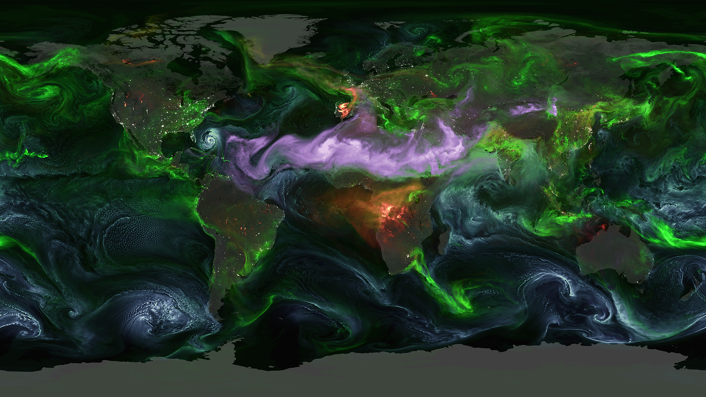

# Órbita Sonora

Órbita Sonora convierte imágenes en música y partituras. Selecciona una imagen, elige cómo recorrer sus píxeles y toca un arreglo para guitarra. Tres guitarras de nailon tocan las bandas roja, verde y azul. `Tone.Sampler` reproduce muestras de notas aisladas según los valores de la imagen.

Proyecto de **Orbidata Analytics** y el **Semillero de Astronomía, Instrumentación y Ciencias Espaciales del ITM**. [Abrir el visor](https://orbidataanalytics.github.io/OrbitaSonora/) · [Publicar en GitHub](PUBLICAR.md)

## 1. Dos imágenes para escuchar

### Luces nocturnas entre 2012 y 2023


Elige esta imagen, deja la cuadrícula en **32 × 32** y empieza con el recorrido **Líneas por filas**. Pulsa **Tocar arreglo** y sigue el cursor de la partitura. Cambia a **Curva de Hilbert** para oír los mismos píxeles en otro orden. [Imagen de NASA SVS](https://svs.gsfc.nasa.gov/5313/)

### Aerosoles GEOS



Compara una zona de **5 × 5** con una de **9 × 9**. En **Análisis de la imagen** puedes ver qué píxeles quedan dentro del recuadro verde. La guitarra intercala bajos y notas agudas. En los tramos con más contraste puede subdividir el pulso. [Imagen de NASA SVS](https://svs.gsfc.nasa.gov/5669/)

## 2. Cómo pasa la imagen a la partitura

1. La aplicación lee la cuadrícula en el orden elegido. Cada celda aporta el 70 % de su RGB y sus vecinos válidos aportan el 30 %. La opción **1 × 1** usa el RGB de cada celda.
2. El brillo y la relación entre los tres canales eligen las tríadas. La textura se estima con la dispersión del brillo, la diferencia entre centro y vecinos y los cambios entre celdas consecutivas. En el ritmo **Según el contraste**, estos cambios determinan dónde sostener o subdividir el pulso.
3. La guitarra roja toca los bajos, la verde alterna el pulgar con la melodía principal y la azul toca las notas agudas. La intensidad de cada banda modula el volumen durante la nota. Los valores altos se acentúan respecto al máximo de cada banda.
4. La vista inicial muestra pentagrama y tablatura a **68 negras por minuto**, con cuerdas al aire y trastes hasta el **7**. El nivel **Inicial** limita la digitación al traste 5. Ajusta el tempo y la tónica sobre la partitura. El visor muestra la nota de cada guitarra durante el recorrido. Puedes exportar **MusicXML**, **MIDI**, **WAV** o imprimir.

Los cambios en la cuadrícula, el recorrido y la velocidad se aplican antes de generar la música. **Abrir informe**, junto a la partitura, reúne el análisis y todos los compases de la vista musical para imprimirlos o descargar un HTML.

## 3. Instrumentos, voz y video

- **DAW** permite elegir por pista entre acústica de nailon, acústica de acero y eléctrica limpia. Marca **Solo** en la de guitarra para ensayarla por separado. **Probar** toca una nota del instrumento elegido y **Restaurar mezcla** devuelve el balance inicial.
- **Activar voz y letra para cantar** añade una parte vocal de guía y muestra una letra editable. En **Partitura general** verás cuatro partes. La voz de guía usa el brillo general de la imagen y las tríadas de cada zona. Para que se oiga a un cantante, carga una toma real en **Añadir una voz grabada** y alinéala con el inicio y el tempo del arreglo.
- **Abrir MP4** reproduce una grabación de tu equipo en el recuadro de GOES. Pulsa la miniatura del satélite para volver a la imagen. Para publicar un video, elige primero el disco y usa la ruta indicada en pantalla, como `videos/svs_5669/interpretacion.mp4`. [Carpetas de los videos](videos/README.md)

## 4. Ejecutar y editar

En Windows, abre `ABRIR_ORBITA.bat`. Desde una terminal también puedes iniciar el visor local.

```bash
python3 scripts/abrir_local.py
```

[Visor local](http://127.0.0.1:8000/) · [Mapa de módulos y pruebas](ARQUITECTURA.md) · [Guía de publicación](PUBLICAR.md)

El visor funciona desde GitHub Pages. La API de conversión de medios, mezcla de MP4 y entrada MIDI/RGB en vivo se ejecuta en FastAPI. [Documentación de la API](https://orbitasonora.onrender.com/docs)

## 5. Créditos

El código usa Apache 2.0. Las imágenes conservan sus créditos de NASA y NOAA. Las muestras de Meta Open Sound y FreePats están bajo CC0 1.0. [Licencia del proyecto](LICENSE) · [Origen de cada muestra instrumental](web/muestras/FUENTES.md) · [Tone.js 15.1.22](https://tonejs.github.io/docs/15.1.22/classes/Sampler.html)
