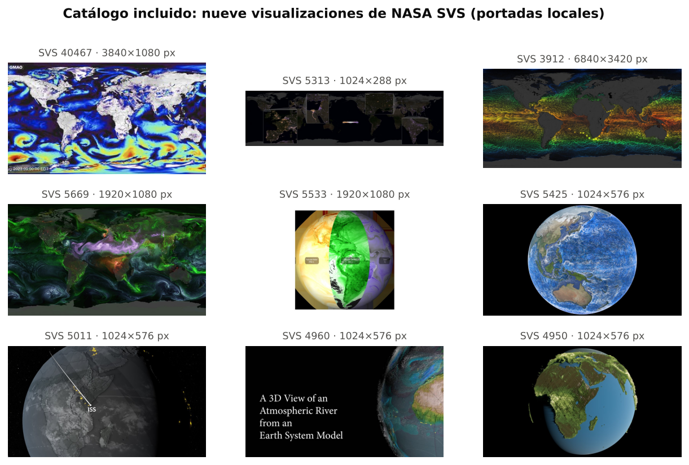
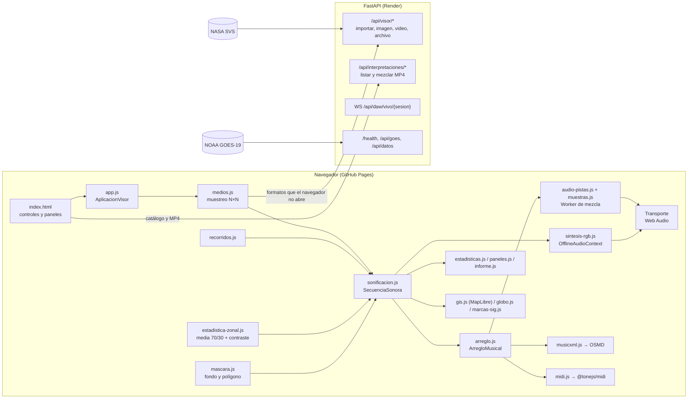
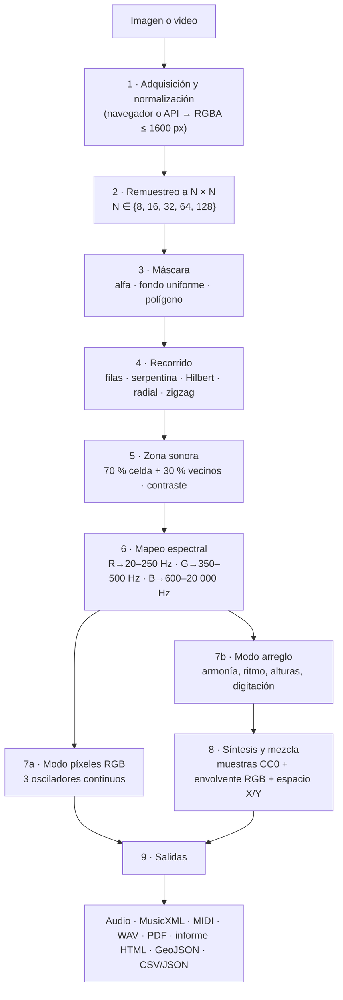
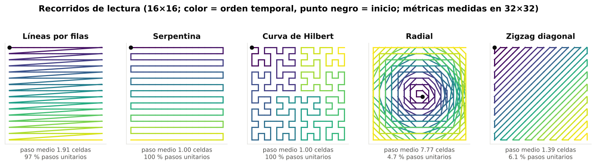
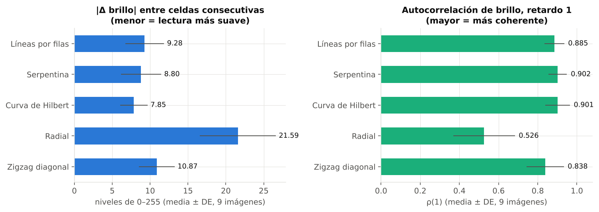
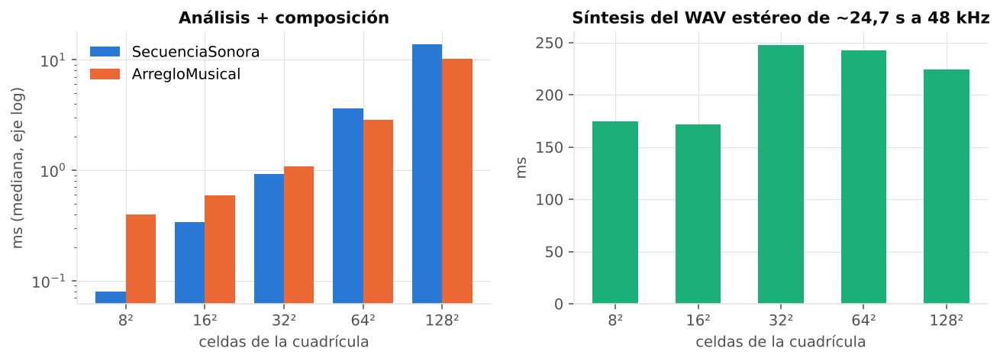

# Órbita Sonora

**Del análisis espectral de imágenes a la música: sonificación RGB, arreglo para guitarra y partitura en el navegador.**

Proyecto de **Orbidata Analytics** y el **Semillero de Astronomía, Instrumentación y Ciencias Espaciales del ITM** (Medellín, Colombia) · versión **5.8.0** · código bajo **Apache-2.0**.

[▶ Abrir el visor en línea](https://orbidataanalytics.github.io/Orbita_Sonora/) · [Documentación de la API](https://orbitasonora.onrender.com/docs) · [Mapa de módulos](ARQUITECTURA.md) · [Guía de publicación](PUBLICAR.md) · [Leer primero](LEER_PRIMERO.md)


*Figura 1. Las nueve visualizaciones de NASA SVS que trae el catálogo [34]. Cada una se puede escuchar, leer como partitura y exportar.*

---

## Contenido

1. [Resumen](#1-resumen)
2. [Inicio rápido (para cualquier persona)](#2-inicio-rápido-para-cualquier-persona)
3. [Marco conceptual: de la luz al sonido](#3-marco-conceptual-de-la-luz-al-sonido)
4. [Trabajos relacionados y referentes](#4-trabajos-relacionados-y-referentes)
5. [Arquitectura del sistema](#5-arquitectura-del-sistema)
6. [Metodología](#6-metodología)
7. [Implementación del frontend](#7-implementación-del-frontend)
8. [Implementación del backend](#8-implementación-del-backend)
9. [Resultados I: cómo se usa y qué funcionalidades hay](#9-resultados-i-cómo-se-usa-y-qué-funcionalidades-hay)
10. [Resultados II: evaluación cuantitativa](#10-resultados-ii-evaluación-cuantitativa)
11. [Comparación con herramientas similares](#11-comparación-con-herramientas-similares)
12. [Discusión](#12-discusión)
13. [Conclusiones](#13-conclusiones)
14. [Ejecutar, probar y publicar](#14-ejecutar-probar-y-publicar)
15. [Licencias y créditos](#15-licencias-y-créditos)
16. [Referencias (IEEE)](#16-referencias-ieee)

---

## 1. Resumen

Órbita Sonora es una aplicación web que **escucha imágenes**. Toma una imagen (o un tramo de video), la reduce a una cuadrícula de *N × N* celdas, separa cada celda en sus tres bandas de color —rojo (R), verde (G) y azul (B)— y recorre la cuadrícula en un orden elegido (filas, serpentina, curva de Hilbert, radial o zigzag). Cada banda se convierte en una voz: **R suena en el registro grave, G en el medio y B en el agudo**, igual que en el espectro electromagnético el rojo tiene menor frecuencia que el azul. Sobre esa lectura “espectral” el sistema compone un **arreglo tonal para tres guitarras** (bajos, pulgar‑melodía y agudos), con armonía elegida por el color de cada zona, ritmo guiado por el contraste local, digitación tocable (trastes ≤ 7) y partitura con tablatura exportable a **MusicXML, MIDI, WAV y PDF**.

En la evaluación de este informe, sobre las 9 imágenes del catálogo con la configuración por defecto (32 × 32, zona 5 × 5, 24 s, Do mayor, 68 negras/min):

| Indicador | Valor medido |
| --- | --- |
| Compases generados por imagen | **7** (24,706 s) |
| Notas por arreglo (3 pistas) | **107 – 135** (media 123,4) |
| Notas que pertenecen al acorde de su zona | **100 %** |
| Traste máximo usado | **7** (nivel intermedio) |
| Reducción del salto de brillo con Hilbert frente a filas | **−15,4 %** (7,85 vs 9,28 niveles) |
| Tiempo de análisis + composición (32 × 32) | **≈ 2 ms** |
| Tiempo de síntesis del WAV de 24,7 s | **165 – 301 ms** (≈ 80–150 × más rápido que tiempo real) |

Las cifras, el método de medición y su reproducción se detallan en la [sección 10](#10-resultados-ii-evaluación-cuantitativa).

---

## 2. Inicio rápido (para cualquier persona)

No necesitas instalar nada: abre **[el visor](https://orbidataanalytics.github.io/Orbita_Sonora/)** en Chrome, Edge, Firefox o Safari recientes.

1. **Elige una imagen** en *Imágenes para escuchar* (o pulsa **Cargar imagen** para usar la tuya).
2. Deja **Cuadrícula = 32 × 32** y **Recorrido = Líneas por filas**.
3. Pulsa **▶ Tocar arreglo** (o el botón verde de la rocola). Verás avanzar el cursor sobre la imagen y sobre la partitura.
4. Cambia el **Recorrido** a **Curva de Hilbert** y vuelve a tocar: son los mismos píxeles en otro orden, y la música cambia.
5. En **Partitura musical** navega por compases y descarga **MusicXML**, **MIDI**, **WAV** o imprime a **PDF**.
6. **Informe con partitura** reúne la imagen original, sus canales, el análisis y todos los compases en un HTML imprimible.

Dos ejemplos guiados:

| Imagen | Qué probar |
| --- | --- |
| **Luces nocturnas 2012–2023** (SVS 5313) | 32 × 32, empieza con *Líneas por filas* y cambia a *Curva de Hilbert*. La lectura y la partitura se recalculan. |
| **Aerosoles GEOS** (SVS 5669) | Compara *Zona sonora* 5 × 5 con 9 × 9. El recuadro verde del *Recorrido RGB* marca los vecinos. En los tramos de más contraste la guitarra subdivide el pulso. |

Para usarlo en tu equipo: en Windows abre `ABRIR_ORBITA.bat`; en cualquier sistema ejecuta `python3 scripts/abrir_local.py` y entra a <http://127.0.0.1:8000/>.

---

## 3. Marco conceptual: de la luz al sonido

**Sonificación** es usar sonido no verbal para representar datos [1], [2]. La técnica más extendida es el **mapeo de parámetros** (*parameter mapping*): cada variable de los datos controla un atributo del sonido, y la altura tonal (*pitch*) es con mucha diferencia el atributo más usado [3]. Una imagen, a diferencia de una serie de tiempo, **no tiene tiempo propio**: hay que decidir *en qué orden* se recorre. Yeo y Berger distinguen el **barrido** (*scanning*, un recorrido fijo que cubre la imagen) del **sondeo** (*probing*, el usuario elige qué zona escuchar) [4], [5], y mostraron que el barrido tipo *raster* es un puente natural entre una y dos dimensiones [6].

En Órbita Sonora la palabra **“espectral”** tiene un sentido doble:

* **Espectro de la imagen.** Cada píxel es una muestra del espectro visible en tres bandas (R, G, B). En productos satelitales como GeoColor de GOES, esas bandas son a su vez combinaciones de canales del instrumento ABI [24], [25]; en las luces nocturnas, provienen de la radiancia nocturna de VIIRS [26].
* **Espectro del sonido.** Cada banda de color se asigna a una **banda de frecuencias audibles** ordenada como en la luz: el rojo (menor frecuencia óptica) va a los graves y el azul (mayor frecuencia óptica) a los agudos. Así, “escuchar” el canal R es escuchar la parte baja del espectro de la imagen.

El proyecto añade una capa que los sonificadores científicos suelen evitar: **musicalizar** la señal (tonalidad, acordes, compás, digitación de guitarra). Es una decisión de diseño orientada a divulgación y educación musical, y su efecto sobre la fidelidad del dato se discute en la [sección 12](#12-discusión).

---

## 4. Trabajos relacionados y referentes

### 4.1 Sonificación de imágenes

| Referente | Idea clave | Relación con Órbita Sonora |
| --- | --- | --- |
| **The vOICe** — Meijer, 1992 [7] | Convierte imágenes de cámara en sonido con un mapeo invertible: barrido por columnas, altura según la posición vertical y volumen según el brillo, hasta 64 × 64 píxeles y 16 tonos de gris. | Mismo principio de barrido temporal; Órbita Sonora usa el **color** para la altura y añade recorridos no lineales. |
| **Yeo y Berger** — 2005–2006 [4]–[6] | Marco *scanning/probing* y barrido *raster* para sonificar texturas. | Los cinco recorridos implementan variantes de *scanning*; marcar píxeles y la vista por cursor son una forma de *probing*. |
| **Chandra “A Universe of Sound”** — NASA/CXC [9], [10] | Sonificaciones curadas de imágenes astronómicas: barridos izquierda‑derecha, radiales o tipo radar; brillo → volumen, posición vertical o color → altura. Estudio con 3 184 participantes [9]. | Inspiración directa para usar imágenes científicas de NASA y mapear color a altura. Diferencia: allí el resultado es un video producido; aquí el usuario controla el mapeo y obtiene la partitura. |
| **Sonificación en astronomía** — Zanella et al., 2022 [8] | Revisión de casi 100 proyectos; el mapeo de parámetros es el método más común y hace falta más evaluación. | Marco de referencia para la [discusión](#12-discusión). |
| **Mapeos de magnitudes físicas** — Dubus y Bresin, 2013 [3] | 179 publicaciones revisadas: el *pitch* domina; pocas evalúan la eficacia del mapeo. | Justifica el mapeo intensidad → frecuencia y señala la necesidad de pruebas con oyentes. |

### 4.2 Síntesis espectral a partir de imágenes

* **ANS de Evgeny Murzin (1938–1958)** y su simulador **Virtual ANS** [33]: la imagen se lee como un **sonograma** (eje vertical = frecuencia), con generadores de tonos puros.
* **Photosounder** [32]: editor que trata la imagen como espectrograma; permite ajustar el rango y la escala de frecuencias y guardar WAV.

Estas herramientas sintetizan el sonido **directamente del espectro** (cada fila es una frecuencia). Órbita Sonora, en cambio, **resume** cada celda en tres números y los convierte en notas musicales.

### 4.3 Sonificación de datos en la web y en Python

* **TwoTone** (Sonify / Google News Initiative) [31]: datos tabulares a música, todo en el navegador; desarrollo pausado desde 2023.
* **Highcharts Sonification Studio** [27]: hoja de cálculo + gráfica + sonido, con énfasis en accesibilidad.
* **STRAUSS** [28], **Astronify** [30] y **SonoUno** [29]: paquetes científicos (Python) para series, espectros y cubos de datos.

### 4.4 Fundamentos técnicos usados

| Tema | Fuente | Dónde se usa |
| --- | --- | --- |
| Curva de Hilbert y su preservación de localidad | Hilbert [12]; Moon et al. [11] | `web/js/recorridos.js` |
| Tablas de áreas sumadas (imagen integral) | Crow [13]; Viola y Jones [14] | `web/js/visor/estadistica-zonal.js` |
| Percepción logarítmica de la altura | Stevens et al. [15]; Walker [16] | Escala de frecuencia por defecto |
| Web Audio y Tone.js | W3C [18]; Mann [17] | Síntesis, mezcla y afinación |
| MusicXML y MIDI | Good [19]; MMA [20] | Exportación de partituras |
| MobileNet cuantizado a 8 bits | Howard et al. [21]; Jacob et al. [22]; ImageNet [23] | Letra opcional (`modelo-imagen.js`) |

---

## 5. Arquitectura del sistema

El sistema tiene dos mitades independientes:

* **Frontend estático** (HTML + CSS + módulos ES de JavaScript, ~5 060 líneas propias). Hace **todo** el análisis, la composición y la síntesis en el navegador. Se publica en GitHub Pages.
* **Backend FastAPI** (Python, ~1 120 líneas en `api/`). Solo se usa para lo que el navegador no puede hacer bien: decodificar formatos científicos o RAW, normalizar videos, leer páginas de NASA sin problemas de CORS, mezclar MP4 con FFmpeg y retransmitir eventos MIDI/RGB por WebSocket. Se despliega en Render.



*Figura 2. Arquitectura. Las flechas internas del navegador siguen el flujo de datos de una reproducción.*

### 5.1 Estructura del repositorio

```text
Orbita_Sonora/
├── index.html              # Página única del visor (310 líneas de marcado)
├── main.py                 # Entrada de Render: app = crear_app()
├── api/                    # Backend FastAPI
│   ├── aplicacion.py       #   crea la app, CORS, GZip, rutas y archivos estáticos
│   ├── rutas/              #   sistema.py, visor.py, daw.py, interpretaciones.py
│   └── visor/              #   catalogo.py, imagenes.py, videos.py, red.py, tipos.py, interpretaciones.py
├── web/
│   ├── js/                 # Frontend: recorridos, estadísticas y 28 módulos en js/visor/
│   ├── css/                # 5 hojas de estilo
│   ├── muestras/           # Bancos de notas grabadas (guitarras, piano) CC0
│   ├── modelo/             # MobileNet V1 0,25 cuantizado int8 (493 488 bytes)
│   ├── geo/                # Teselas Blue Marble, GeoJSON de tierra, respaldo GOES
│   ├── vendor/             # Tone.js, @tonejs/midi, OpenSheetMusicDisplay, MapLibre
│   └── fonts/              # DM Sans, Space Grotesk (OFL)
├── datos/                  # fuentes-svs.json y 9 paquetes con manifiesto, portada y original
├── videos/                 # Carpeta de interpretaciones MP4 por paquete
├── scripts/                # servir, abrir_local, actualizar_catalogo, indexar_videos, preparar_github…
├── pruebas/                # sonificacion.mjs (Node) y verificar.py (FastAPI)
└── docs/                   # logos, huellas SHA-256 y este informe (docs/informe/)
```

### 5.2 Tecnologías

| Capa | Tecnología (versión incluida) | Papel |
| --- | --- | --- |
| Interfaz | HTML5, CSS, módulos ES nativos (sin empaquetador) | Página única, sin dependencias de compilación |
| Audio | Web Audio API [18], **Tone.js 15.1.22** [17] | Reproducción, `OfflineAudioContext`, cálculo de intervalos de afinación |
| Partitura | **OpenSheetMusicDisplay 1.9.8** | Render de MusicXML con tablatura |
| MIDI | **@tonejs/midi 2.0.28** | Lectura y escritura de archivos `.mid` |
| Mapas | **MapLibre GL JS 5.6.0** + globo propio en canvas | Georreferenciación 2D/3D |
| IA ligera | MobileNet V1 (ancho 0,25, 128 px) cuantizado int8 [21], [22] | Tema visual para la letra (opcional, en Worker) |
| API | **FastAPI** ≥ 0.115, Uvicorn | Endpoints REST y WebSocket |
| Imágenes | Pillow, pillow‑heif, **rasterio** (GeoTIFF/JP2), **rawpy** (RAW), **astropy** (FITS) [36] | Normalización a PNG RGBA |
| Video | **PyAV** (FFmpeg), imageio‑ffmpeg | Recorte y normalización H.264; mezcla de MP4 |
| Red segura | httpx, lxml | Descarga controlada y lectura de páginas SVS |

---

## 6. Metodología

La cadena completa es determinista: la misma imagen con los mismos ajustes produce siempre la misma partitura y el mismo audio (las semillas de ruido son fijas).



*Figura 3. Flujo metodológico.*


*Figura 4. Pasos 2 a 5 sobre las luces nocturnas (SVS 5313): (a) original, (b) cuadrícula 32 × 32, (c–e) canales R, G y B (escalados a su máximo), (f) señal después de la zona 5 × 5 y (g) mapa de contraste local.*

### 6.1 Adquisición y normalización

* **Formatos web** (JPG, PNG, WebP, GIF, AVIF…) se decodifican en el navegador.
* **Formatos científicos o de cámara** viajan a `POST /api/visor/archivo` o `GET /api/visor/imagen`. `LectorImagen` (`api/visor/imagenes.py`) decide por extensión y por *firma de bytes*:
  * **RAW** (DNG, CR2, NEF, ARW… 22 extensiones) → `rawpy`, revelado con balance de blancos de cámara.
  * **FITS** → `astropy`, primer plano 2D/3D válido.
  * **GeoTIFF / JPEG 2000** → `rasterio`; se respetan las bandas R, G, B y alfa declaradas, la paleta indexada y, si hay CRS, se calculan las **cuatro esquinas en WGS84** para georreferenciar.
  * Datos de 16 bits o flotantes se escalan por **percentiles 2–98** por banda, que evita que unos pocos píxeles extremos aplasten el contraste.
* Todo sale como **PNG RGBA** con lado máximo de 1 600 px (Lanczos) y metadatos en la cabecera `X-Orbita-Imagen`. Límites: 40 MiB por imagen, 90 millones de píxeles.
* **Video**: el navegador toma hasta **120 fotogramas** (6 por segundo) de un tramo de hasta **60 s**. Si el códec no es reproducible, `LectorVideo` (PyAV) recorta y recodifica a H.264 (≤ 960 px, ≤ 30 fps, CRF 24). El fotograma usado en cada celda depende del instante de lectura, de modo que el video “avanza” con la música.

### 6.2 Remuestreo a la cuadrícula

`LectorMedios.muestrear()` dibuja la imagen en un canvas de *N × N* (`drawImage`) y lee sus valores RGBA. La relación de aspecto **no se conserva**: la imagen se estira a un cuadrado, porque los recorridos (en especial Hilbert) necesitan una cuadrícula cuadrada con lado potencia de dos.

Cada celda recibe un intervalo de tiempo fijo:

$$\Delta t = \frac{T}{N^2}, \qquad T = \frac{\text{duración elegida}}{\text{velocidad de lectura}}$$

Con 24 s y 32 × 32, cada celda dura **23,4 ms**; con 128 × 128, **1,46 ms**.

### 6.3 Máscara: qué píxeles cuentan

`MascaraMedio` (`mascara.js`) ofrece tres modos:

1. **Transparencia original**: un píxel con alfa 0 se marca como *no válido* y suena en silencio.
2. **Quitar fondo uniforme**: se muestrea el perímetro, se agrupan colores en cubos de 24 niveles, se elige un candidato que cubra ≥ 52 % del borde (≥ 62 % si el color es saturado) y se elimina por **inundación desde el borde** (búsqueda en anchura) todo lo que esté a una distancia euclidiana RGB ≤ tolerancia × 1,35. Así no se borran zonas interiores del mismo color.
3. **Solo área seleccionada**: polígono de ≥ 3 puntos; la pertenencia se calcula con el algoritmo de cruce de rayos (*ray casting*). En video, el mismo polígono aplica a todos los fotogramas.

### 6.4 Recorridos (de 2D a 1D)

`coordenadasRecorrido(lado, recorrido)` devuelve una permutación de las *N²* celdas. La prueba automática exige que **cada celda aparezca exactamente una vez** y que en Hilbert cada paso sea a un vecino (distancia Manhattan 1).

| Recorrido | Construcción | Propiedad |
| --- | --- | --- |
| Líneas por filas | Raster clásico izquierda → derecha, arriba → abajo [6] | Salto de *N − 1* celdas al cambiar de fila |
| Serpentina | Filas alternando sentido (*boustrophedon*) | Siempre pasos unitarios |
| **Curva de Hilbert** | Conversión índice → (x, y) por cuadrantes con rotación/reflexión [12] | Mejor preservación de localidad entre curvas de llenado [11] |
| Radial | Celdas ordenadas por distancia al centro y luego por ángulo | Escucha “de adentro hacia afuera”, como algunas sonificaciones de Chandra [10] |
| Zigzag diagonal | Antidiagonales alternas (como el orden JPEG) | Pasos diagonales |


*Figura 5. Los cinco recorridos sobre 16 × 16. El color va del morado (inicio) al amarillo (final).*

### 6.5 Zona sonora: media espacial 70/30 y contraste

Para que una celda aislada no domine la melodía, cada celda se mezcla con su vecindario cuadrado de lado *k* ∈ {1, 3, 5, 7, 9, 15, 21} (por defecto 5):

$$\mathbf{c}_{\text{sonoro}} = 0{,}7\,\mathbf{c}_{p} + 0{,}3\,\overline{\mathbf{c}}_{\text{vecinos válidos}}$$

donde **c** = (R, G, B) premultiplicado por alfa. El brillo se define con más peso para el verde, que es el canal al que el ojo es más sensible:

$$Y = \frac{R + 2G + B}{4}$$

El **contraste local** combina la dispersión del brillo en la zona y la diferencia entre la celda y sus vecinos:

$$\kappa = \min\!\left(255,\ \operatorname{round}\big(0{,}66\,\sigma_Y + 0{,}34\,|Y_p - \overline{Y}_{\text{vec}}|\big)\right)$$

Para que el costo no crezca con *k*, `MediaZonal` construye **cuatro tablas de áreas sumadas** (R, G, B y número de celdas válidas) más una de *Y²* [13], [14]. Cada consulta cuesta 4 lecturas por tabla, sin importar el tamaño de la zona: el análisis completo es **O(N²)**. La prueba incluida verifica el caso exacto: una celda (100, 50, 20) rodeada de negro da (70, 35, 14).

### 6.6 Mapeo espectral: intensidad → frecuencia

Cada canal tiene su banda audible (`BANDAS` en `sonificacion.js`) y se precalculan tablas de 256 valores. El nivel 0 es **silencio**; los niveles 1–255 se reparten así:

$$f_c(v) = \begin{cases} f_{\min}\left(\dfrac{f_{\max}}{f_{\min}}\right)^{\frac{v-1}{254}} & \text{logarítmica (por defecto)}\\[2mm] f_{\min} + (f_{\max}-f_{\min})\,\dfrac{v-1}{254} & \text{lineal}\end{cases}$$

| Canal | Clave | Banda | Extensión | Paso por nivel (escala log) |
| --- | --- | --- | --- | --- |
| R | Fa | 20 – 250 Hz | 43,7 semitonos (3,6 octavas) | 0,17 semitonos |
| G | Sol | 350 – 500 Hz | 6,2 semitonos | 0,024 semitonos (≈ 2,4 cents) |
| B | Sol | 600 – 20 000 Hz | 60,7 semitonos (5,1 octavas) | 0,24 semitonos |

La escala logarítmica hace que pasos iguales de intensidad suenen como intervalos musicales iguales, en línea con la percepción de la altura [15]; la polaridad “más intenso = más agudo” coincide con la que la mayoría de oyentes espera para magnitudes [16]. La conversión a nota MIDI es la estándar:

$$m = \operatorname{round}\!\left(69 + 12\log_2\frac{f}{440}\right)$$


*Figura 6. Curvas intensidad → frecuencia de las tres bandas en escala logarítmica y lineal.*

### 6.7 Del mapeo a la música: `ArregloMusical`

El **modo píxeles RGB** (`sintesis-rgb.js`) es la sonificación “pura”: tres osciladores sinusoidales cuya frecuencia salta celda a celda según la tabla anterior y cuya amplitud es 0,30 · volumen · *v*/255, con rampas de 0,65 ms para evitar clics.

El **modo arreglo** (por defecto) convierte la misma lectura en música tocable:

1. **Tiempo musical.** Con tempo *b* (negras/min) y compás *p/q*, la unidad mínima es una semicorchea de 60/(*b* · 4) s. El número de compases es ⌈*T* / duración del compás⌉. A 68 negras/min en 4/4, 24 s dan **7 compases** (24,706 s).
2. **Armonía por zona de color.** Cada medio compás se resume en una intensidad media por canal. Su brillo relativo y el balance de color eligen un grado de la tonalidad (`gradoPorColor`):
   * rojo dominante (R − B > umbral) → **V** o **IV**, azul dominante → **ii** o **iii**, verde dominante → **I** o **vi**;
   * sin color dominante, el brillo relativo recorre **I → ii → V → IV**.
   En modo menor se usan los acordes equivalentes. Las 12 tónicas y los modos mayor/menor están disponibles.
3. **Ritmo según el contraste.** Para cada pulso se mide la **textura** = contraste ponderado + cambios entre celdas consecutivas. Si supera 18 en tiempo fuerte (10 en débil), el pulso se divide en dos corcheas; por encima de 28, en nivel intermedio, se divide en tres. También hay ritmos fijos: pulso, corcheas y semicorcheas.
4. **Alturas.** Cada pista usa solo notas del acorde vigente dentro de su registro. La melodía se reescala entre los percentiles 10 y 88 de la propia imagen, para que una imagen oscura también use todo el diapasón; se limita el salto melódico (5 semitonos en nivel inicial, 7–12 en intermedio).
5. **Papel de cada guitarra.** R toca los **bajos** (fundamental o quinta del acorde según la tendencia), G **alterna pulgar y melodía** (bajo en tiempos fuertes, melodía en los demás) y B las **notas agudas**.
6. **Digitación.** Para cada nota se buscan todas las posiciones (cuerda, traste) con traste ≤ 5 (inicial) o ≤ 7 (intermedio), restringiendo cuerdas graves a los bajos y agudas a la melodía, y se escoge la de menor costo:
   $$\text{costo} = 0{,}18\,\text{traste} + 0{,}45\,|\Delta\text{traste}| + 0{,}36\,|\Delta\text{cuerda}|$$
   Hay cinco afinaciones: guitarra estándar, requinto, tiple requinto en Do y en Si♭, y bajo de cuatro cuerdas.
7. **Dinámica y acentos.** Velocidad = max(0,12, (*I*/255)^0,63); cada compás recibe *p*, *mp*, *mf* o *f* según su media; se acentúan los tiempos fuertes intensos.
8. **Voz opcional.** `vozCantante()` genera una cuarta parte en el rango La3–Do5, con notas del acorde cercanas a un centro que depende del brillo global. La letra se compone a partir del tema de la imagen (catálogo NASA) o de lo que reconoce MobileNet (fotos propias).


*Figura 7. Arreglo generado para SVS 5313. Cada barra es una nota; su opacidad es la intensidad. Las franjas superiores muestran el acorde elegido por el color de cada zona.*

### 6.8 Síntesis, mezcla y espacio

* **Muestras grabadas.** Cuatro bancos MP3 mono a 24 kHz (guitarra de nailon, de acero, eléctrica limpia y piano) con notas aisladas de 1,5 s. Para cada nota se toma la muestra grabada más cercana y se transpone con la razón `Tone.intervalToFrequencyRatio(semitonos)`, con interpolación lineal.
* **Timbres sintéticos** de respaldo (aditivos y de ruido para percusión) en `Voz`.
* **Envolvente RGB.** Mientras una nota suena, su volumen sigue la intensidad de la banda celda a celda (suavizado de 3 ms): en guitarra 0,62 √(*I*/255) + 0,38 (*I*/*I*ₘₐₓ)^2,3.
* **Espacio según la posición del píxel** (`espacioPixel`):
  * panorama = pan de la pista + (2*x* − 1) · espacio (por defecto 65 %), con ley de potencia constante;
  * reverberación = reverb · (0,08 + 0,92 · distancia al centro), es decir, más eco en los bordes;
  * filtro opcional según *Y*: corte = 600 + 10 500 (1 − *y*)² Hz (arriba = brillante, abajo = opaco).
* La mezcla se calcula en un **Web Worker** (sin bloquear la interfaz), a 48 kHz estéreo; si el navegador no tiene Workers, se calcula en el hilo principal.

---

## 7. Implementación del frontend

### 7.1 Módulos principales

| Módulo | Clase o función | Responsabilidad |
| --- | --- | --- |
| `visor/app.js` (700 líneas) | `AplicacionVisor` | Estado del medio, enlace de controles, recalcula secuencia y arreglo al cambiar un ajuste |
| `visor/medios.js` | `LectorMedios` | Abrir imagen/video, muestrear *N × N*, fotogramas de video |
| `recorridos.js` | `coordenadasRecorrido`, `puntoHilbert` | Orden de lectura |
| `visor/estadistica-zonal.js` | `MediaZonal` | Imagen integral, media 70/30, contraste |
| `visor/mascara.js` | `MascaraMedio` | Alfa, fondo uniforme, polígono |
| `visor/sonificacion.js` | `SecuenciaSonora`, `Transporte` | Tablas de frecuencia, reloj de reproducción, caché de audio por modo, cancelación con `AbortController` |
| `visor/arreglo.js` (385 líneas) | `ArregloMusical` | Armonía, ritmo, alturas, digitación, voz |
| `visor/audio-pistas.js`, `audio-worker.js` | `renderizarArreglo`, `Voz` | Mezcla en Worker y codificación WAV |
| `visor/muestras.js` | `prepararMuestras` | Bancos CC0, recorte y transposición con Tone.js |
| `visor/musicxml.js`, `partitura-musical.js`, `visor-partituras.js` | `MusicXML` | Escritura MusicXML 4 partes, pentagrama + tablatura con OSMD, cursor sincronizado |
| `visor/midi.js` | `ArchivosMIDI` | Exportar/importar `.mid` (corrige la armadura que desplaza @tonejs/midi 2.0.28) |
| `visor/daw.js`, `audio-vivo.js` | `EstudioDAW`, `AudioVivo` | Mezclador de 3 pistas, solo/mute, instrumento, reproducción de MIDI local |
| `estadisticas.js`, `visor/paneles.js`, `visor/informe.js` | `calcularInforme` | Firmas RGB, histogramas, píxeles destacados, informe HTML |
| `visor/gis.js`, `globo.js`, `marcas-sig.js` | — | Georreferencia (punto o 4 esquinas), mapa MapLibre, globo en canvas, exportación GeoJSON |
| `visor/modelo-imagen.js`, `letra.js`, `voz-grabada.js` | `clasificar` | Inferencia MobileNet int8 en Worker, letra, toma vocal del usuario |

### 7.2 Reproducción sin cortes

`Transporte` guarda un búfer de audio por modo (*arreglo* o *píxeles RGB*). Solo invalida el búfer afectado: cambiar el volumen de una pista rehace la mezcla pero no la partitura; cambiar el recorrido rehace ambas. Al pausar aplica una rampa de 8 ms a cero para evitar clics, y el cursor se sincroniza con `AudioContext.currentTime` mediante `requestAnimationFrame`. Un contador de *generación* descarta resultados de reproducciones que ya fueron reemplazadas.

### 7.3 Análisis de firmas RGB

`calcularInforme()` cuantiza cada celda en *L* ∈ {4, 8, 16} niveles por canal (“firma”), cuenta su frecuencia y produce:

* el **mapa de ocupación** de firmas con un semáforo de colores (frecuentes vs. raras);
* estadísticas por canal (mínimo, máximo, media, mediana, desviación poblacional, P5, P95) e histogramas de 16 intervalos;
* **píxeles destacados automáticos**: máximo de cada canal, máxima intensidad conjunta, mayor cambio de firma entre celdas consecutivas y primera aparición de la firma más frecuente, más las marcas manuales del usuario.

---

## 8. Implementación del backend

### 8.1 Endpoints

| Método | Ruta | Uso |
| --- | --- | --- |
| GET | `/health` | Estado y versión |
| GET | `/api/goes` | URL de la imagen GeoColor GOES‑19 del sector norte de Suramérica (se renueva cada 10 min) |
| GET | `/api/datos` | Metadatos de la rocola |
| GET | `/api/visor/importar?url=` | Lee una página de NASA SVS (o una URL directa) y devuelve un paquete con sus imágenes y videos |
| GET | `/api/visor/imagen?url=` | Descarga y normaliza una imagen remota a PNG |
| GET | `/api/visor/video?url=&convertir=&inicio=` | Transmite un video con soporte de `Range`, o lo recorta y normaliza (≤ 60 s) |
| POST | `/api/visor/archivo` | Normaliza una imagen o video subidos (40 / 80 MiB) |
| GET | `/api/interpretaciones/{carpeta}` | Lista los MP4 publicados de un paquete |
| POST | `/api/interpretaciones/mezclar` | Une un video con tres audios (R, G, B) con ganancia y desfase por pista usando FFmpeg (`amix` + `alimiter`) |
| WS | `/api/daw/vivo/{sesion}` | Sala para retransmitir eventos `note` (pista, nota, velocidad) y `rgb` (tripleta + x, y) validados con Pydantic |
| GET | `/`, `/web`, `/datos`, `/docs`, `/videos` | La misma página del visor y sus archivos estáticos |

### 8.2 Seguridad y robustez

* **Protección SSRF** (`ClientePublico`): solo HTTP/HTTPS en puertos estándar, sin credenciales en la URL; el nombre se resuelve y **todas** las IP deben ser públicas (`ip.is_global`) antes de conectar; la conexión se hace a la IP resuelta con el `Host` y SNI originales (evita *DNS rebinding*); máximo 6 redirecciones, cada una revalidada.
* **Límites de tamaño** comprobados por `Content-Length` y durante la lectura en bloques de 64 KiB.
* **WebSocket**: identificador de sesión hexadecimal de 32 caracteres, máximo 200 salas y 12 clientes por sala, mensajes ≤ 1 000 bytes y ≤ 45 por segundo; esquemas Pydantic con `extra="forbid"`.
* **FFmpeg** con listas blancas de formato y protocolo (`file` únicamente), un solo trabajo de mezcla a la vez (`BoundedSemaphore(1)`) y tiempo máximo de 210 s.
* Cabeceras `X-Content-Type-Options: nosniff`, compresión GZip y CORS configurable con `CORS_ORIGINS`.

### 8.3 Catálogo

`scripts/actualizar_catalogo.py` lee `datos/fuentes-svs.json`, usa `Catalogador` para extraer de cada página de NASA SVS los medios, títulos, descripciones y variantes, descarga una copia local del medio inicial y escribe `datos/paquetes/<id>/paquete.json`. Las huellas SHA‑256 de los originales quedan en `docs/ARCHIVOS_NASA_SHA256.txt`.

---

## 9. Resultados I: cómo se usa y qué funcionalidades hay

### 9.1 Recorrido por la interfaz

| Zona de la página | Controles | Qué hace |
| --- | --- | --- |
| **Encabezado** | Imágenes · Partituras · DAW · **Cargar imagen** | Navegación y carga de archivos o URL |
| **Rocola** | Vinilo, ▶ verde, Ⅱ rojo, *Elige una imagen* | Reproducción rápida del arreglo |
| **Imagen destacada** | GOES‑19 GeoColor en vivo · **Abrir MP4** | Imagen satelital del día sobre Colombia; reproduce un video propio o publicado |
| **Imágenes para escuchar** | Catálogo de 9 paquetes | Selección del medio |
| **Reproducción** | ▶ Tocar arreglo · Pausa · **Informe con partitura** · Tempo (40–168) · Tónica · Volumen · línea de tiempo | Control del transporte |
| **Recorrido** | Recorrido (5) · Cuadrícula (8–128) · Velocidad (0,5–2×) · Zona sonora (1–21) | Cómo se lee la imagen; vista del original, el trazado RGB y los tres canales |
| **Partitura musical** | Vista (G, general, guitarra + voz) · ‹ › · Ir al compás · Seguir reproducción · WAV · MIDI · MusicXML · Imprimir/PDF | Pentagrama + tablatura y exportación |
| **Ajustes de composición** | Modo · Alturas por acorde · Dificultad · Compás (4/4, 3/4, 6/8) · Ritmo · Afinación | Reglas del arreglo |
| **Voz** | Activar voz y letra · Añadir una voz grabada | Cuarta parte vocal y letra editable |
| **DAW · Instrumentos** | Instrumento, volumen, panorama, Solo, Mute, Probar por pista · Reverb en el borde · Panorama según X · Filtro según Y · Restaurar mezcla · Archivo MIDI local | Mezcla |
| **Análisis de la imagen** | Duración (12/24/48 s) · Intensidad a frecuencia (log/lineal) · Agrupar firmas (4/8/16) · Ocupación (completa/hasta el cursor) | Parámetros del análisis |
| **Vista geográfica** | Píxel activo · Mapa 2D · Globo 3D · Georreferenciar · Centrar capa | Ubicar la imagen en la Tierra |
| **Fondo y área** | Transparencia original · Quitar fondo uniforme (tolerancia) · Solo área seleccionada · Delimitar área | Qué píxeles suenan |
| **Firmas RGB** | Firma del píxel · Ocupación de firmas · Marcar píxel · Exportar marcas SIG · Descargar datos | Análisis cuantitativo |

### 9.2 Casos de uso

* **Aula de música**: el docente elige una imagen, baja la dificultad a *Inicial* (trastes ≤ 5) y entrega la partitura en PDF con tablatura para que los estudiantes la toquen.
* **Divulgación científica**: se compara cómo “suena” la diferencia de luces nocturnas o de aerosoles; el recorrido radial permite escuchar del centro hacia los bordes.
* **Análisis exploratorio**: con *Ocupación hasta el cursor* y *Marcar píxel* se registran puntos de interés y se exportan como **GeoJSON** georreferenciado (incluye fila, columna, segundo del recorrido y segundo del video original).
* **Producción**: exportar el MIDI a un DAW externo, o el MusicXML a MuseScore/Finale/Sibelius, para orquestar la idea.

---

## 10. Resultados II: evaluación cuantitativa

### 10.1 Protocolo

Las métricas se obtuvieron **ejecutando los propios módulos del proyecto** (`sonificacion.js`, `arreglo.js`, `audio-pistas.js`, `estadisticas.js`, `musicxml.js`) en **Node.js 22** sobre las 9 imágenes del catálogo:

* Remuestreo a *N × N* con Pillow (bilineal), como aproximación al `drawImage` del navegador.
* Configuración por defecto de la web: 32 × 32, zona 5 × 5, 24 s, velocidad 1×, escala logarítmica, Do mayor, 68 negras/min, 4/4, ritmo *según el contraste*, nivel intermedio, afinación estándar, tres guitarras de nailon.
* El audio se sintetizó con los **timbres de respaldo** (en Node no se decodifican los MP3); la estructura de notas es idéntica a la del navegador.
* Tiempos: mediana de 15 ejecuciones para análisis y composición y de 3 para la síntesis, en un contenedor Linux; son indicativos y dependen del equipo.

Los scripts y datos crudos están en [`docs/informe/reproducir/`](docs/informe/reproducir/) y [`docs/informe/resultados.json`](docs/informe/resultados.json).

### 10.2 Resultados por imagen

| SVS | Tema | Celdas válidas | Notas R / G / B | Total | Acordes distintos | Firmas (8 niv.) | Firma dominante | Contraste medio |
| --- | --- | ---: | ---: | ---: | ---: | ---: | ---: | ---: |
| 40467 | Tierra desde el espacio (EIC) | 1024 | 28 / 53 / 54 | 135 | 3 | 36 | 19,5 % | 12,2 |
| 5313 | Luces nocturnas 2012–2023 | 1024 | 28 / 43 / 43 | 114 | 4 | 10 | 71,8 % | 10,3 |
| 3912 | Corrientes y temperatura oceánica | 1024 | 28 / 40 / 39 | 107 | 5 | 28 | 37,7 % | 8,3 |
| 5669 | Aerosoles GEOS 2025 | 1024 | 28 / 50 / 50 | 128 | 4 | 46 | 19,5 % | 13,6 |
| 5533 | Calidad del aire (esfera) | **436** | 26 / 50 / 50 | 126 | 4 | **86** | 13,8 % | 16,9 |
| 5425 | Perpetual Ocean 2 | 1024 | 27 / 54 / 54 | 135 | 2 | 41 | 13,6 % | 17,0 |
| 5011 | Relámpagos desde la ISS | 1024 | 28 / 44 / 44 | 116 | 4 | 16 | 36,8 % | 9,7 |
| 4960 | Río atmosférico | 1024 | 28 / 47 / 47 | 122 | 5 | 32 | 63,2 % | 11,2 |
| 4950 | Altura de bosques GEDI | 1024 | 27 / 51 / 50 | 128 | 5 | 32 | 17,2 % | 13,3 |

Observaciones:

* Todas las imágenes producen **7 compases (24,706 s)** y entre **107 y 135 notas** (media 123,4; DE ≈ 10).
* **El 100 % de las notas pertenece al acorde de su zona** y **ninguna supera el traste 7**: las restricciones de diseño se cumplen en todos los casos.
* La pista R es la más estable (26–28 notas, aproximadamente una por pulso) porque nunca se subdivide; G y B concentran la variación rítmica.
* SVS 5533 es una esfera sobre fondo transparente: solo 436 de 1 024 celdas (42,6 %) suenan, pero es la de mayor diversidad cromática (86 firmas).
* Las imágenes oscuras y homogéneas (5313, 4960) tienen una firma dominante de 63–72 % y menos acordes; sus compases quedan mayoritariamente en dinámica *p* (7 de 7 en SVS 5313 y 6 de 7 en SVS 4960).


*Figura 8. Izquierda: acordes elegidos en las 126 zonas armónicas (14 por imagen). Sol (V) aparece en el 25,4 %. Derecha: notas por pista.*

### 10.3 Efecto del recorrido

Para cada recorrido se midió, con zona 1 × 1 (sin suavizar) sobre las 9 imágenes: el paso geométrico medio, la diferencia absoluta media de brillo entre celdas consecutivas |Δ*Y*|, la autocorrelación de brillo con retardo 1, ρ(1), y, con zona 5 × 5, el salto melódico medio y el número de notas de la pista G.

| Recorrido | Paso medio (celdas) | Pasos unitarios | \|Δ*Y*\| (media ± DE) | ρ(1) | Salto melódico G (semitonos) | Notas G |
| --- | ---: | ---: | ---: | ---: | ---: | ---: |
| Líneas por filas | 1,91 | 97,0 % | 9,28 ± 2,56 | 0,885 | 11,40 | 48,0 |
| Serpentina | 1,00 | 100 % | 8,80 ± 2,66 | **0,902** | 11,24 | 47,1 |
| **Curva de Hilbert** | 1,00 | 100 % | **7,85 ± 1,81** | 0,901 | 10,72 | **41,7** |
| Radial | 7,77 | 4,7 % | 21,59 ± 5,01 | 0,526 | **9,57** | 50,2 |
| Zigzag diagonal | 1,39 | 6,1 % (resto diagonales) | 10,87 ± 2,37 | 0,838 | 10,52 | 47,9 |


*Figura 9. Suavidad (izquierda) y coherencia (derecha) de la señal de brillo según el recorrido.*

* **Hilbert da la lectura más suave**: |Δ*Y*| es 15,4 % menor que en filas y su dispersión entre imágenes es la menor (DE 1,81). Esto concuerda con su conocida preservación de localidad [11]. Musicalmente produce **13 % menos notas** en la pista G: como el contraste entre celdas sucesivas es menor, se subdividen menos pulsos y se sostienen más las notas.
* **Radial es el recorrido más “nervioso”**: sus pasos son largos (7,8 celdas en promedio) y ρ(1) cae a 0,53. Aun así, su salto melódico es el menor, porque el arreglo limita los saltos y acerca la nota al acorde; la variabilidad se traslada al ritmo (más notas).
* Serpentina y Hilbert tienen ρ(1) casi idéntica (0,902 vs. 0,901); la diferencia está en la escala de bloques: Hilbert recorre zonas compactas, mientras la serpentina recorre bandas horizontales.


*Figura 10. Espectrogramas del audio renderizado para SVS 5313 con filas (izquierda) y Hilbert (derecha). La línea blanca es el centroide espectral. El contenido armónico es el mismo; cambia el orden y la densidad de los ataques.*

### 10.4 Efecto de la zona sonora

| Zona | 1 × 1 | 3 × 3 | 5 × 5 | 7 × 7 | 9 × 9 | 15 × 15 | 21 × 21 |
| --- | ---: | ---: | ---: | ---: | ---: | ---: | ---: |
| Contraste local medio | 0,0 | 8,3 | 12,5 | 15,5 | 17,9 | 23,6 | 27,6 |
| Notas totales (media) | 96,6 | 116,8 | 123,4 | 127,9 | 131,0 | 133,2 | 134,0 |
| Pulsos subdivididos en G | 38,0 % | 75,6 % | 84,7 % | 89,9 % | 92,5 % | 96,2 % | 96,9 % |


*Figura 11. El tamaño de la zona controla la densidad rítmica.*

La zona actúa como un **control de densidad**: pasar de 1 × 1 a 5 × 5 añade un 27,7 % de notas y más que duplica los pulsos subdivididos. Más allá de 9 × 9 el efecto se satura (> 92 %).

### 10.5 Rendimiento

| Cuadrícula | Celdas | Duración por celda | `SecuenciaSonora` | `ArregloMusical` | Síntesis WAV (24,7 s, 48 kHz, estéreo) |
| --- | ---: | ---: | ---: | ---: | ---: |
| 8 × 8 | 64 | 375 ms | 0,08 ms | 0,40 ms | 175 ms |
| 16 × 16 | 256 | 93,8 ms | 0,34 ms | 0,59 ms | 171 ms |
| 32 × 32 | 1 024 | 23,4 ms | 0,92 ms | 1,09 ms | 248 ms |
| 64 × 64 | 4 096 | 5,9 ms | 3,63 ms | 2,86 ms | 243 ms |
| 128 × 128 | 16 384 | 1,5 ms | 13,72 ms | 10,16 ms | 224 ms |


*Figura 12. El análisis crece linealmente con el número de celdas (×256 celdas → ×170 tiempo); la síntesis depende de la duración y del número de notas, no de la cuadrícula.*

Otros datos: el MusicXML de la partitura general pesa en promedio **28,2 KB**; el modelo de imagen pesa **493 488 bytes**; los bancos de muestras ocupan 9,9 MB.

### 10.6 Pruebas automáticas

`node pruebas/sonificacion.mjs` **pasa** en esta revisión. Verifica, entre otros: que los cinco recorridos sean permutaciones; continuidad de Hilbert de 8 a 128; tablas de frecuencia monótonas con extremos exactos; el caso exacto 70/30; trastes ≤ 7 (≤ 5 en inicial) para **las 12 tónicas × 2 modos × 4 afinaciones de guitarra**; que cada nota pertenezca a su acorde y no cruce su límite; que cada compás sume exactamente su duración; que cambiar recorrido, zona o escala cambie el audio (huella SHA‑256); exportación GeoJSON y suma de ocupación = 100 %. `python pruebas/verificar.py` comprueba la API (rutas, versión, 9 paquetes, respuestas parciales 206 y normalización de PNG); requiere instalar `requirements-dev.txt` y no se ejecutó en el entorno de este informe.

---

## 11. Comparación con herramientas similares

| Funcionalidad | **Órbita Sonora** | Chandra *Universe of Sound* [9], [10] | The vOICe [7] | Photosounder [32] / Virtual ANS [33] | TwoTone [31] | Highcharts Sonification Studio [27] | STRAUSS / Astronify / SonoUno [28]–[30] |
| --- | --- | --- | --- | --- | --- | --- | --- |
| Entrada principal | Imagen, video, URL NASA, RAW, FITS, GeoTIFF | Imágenes astronómicas (curadas) | Cámara / imagen | Imagen como espectrograma | Tabla (CSV/hoja) | Tabla | Series, espectros, catálogos |
| Interacción del usuario con el mapeo | Total (recorrido, zona, escala, armonía, mezcla) | No (resultado producido) | Parcial | Total (espectral) | Alta | Alta | Programática |
| Recorridos de lectura | 5 (incl. Hilbert y radial) | Lineal, radial o radar según la pieza | Columnas izquierda → derecha | Eje temporal fijo | Eje de la tabla | Eje X | Según el código |
| Uso de las tres bandas de color | Sí, una voz por banda | Color → altura en algunas piezas | No (gris) | No (intensidad) | — | — | — |
| Arreglo tonal y digitación tocable | **Sí** (acordes, compás, trastes ≤ 7) | Compuesto por músicos | No | No | Escalas musicales | No | No |
| Partitura MusicXML + tablatura | **Sí** | No | No | No | No | No | No |
| Exportación MIDI | Sí | No | No | Entrada MIDI (Virtual ANS) | Salida MIDI en beta | — | Según el paquete |
| Georreferenciación y GeoJSON | **Sí** | No | No | No | No | No | No |
| Análisis estadístico de la imagen | Firmas, histogramas, píxeles destacados | No | No | Espectral | Resumen de datos | Gráfica | Sí (científico) |
| Funciona en el navegador sin instalar | Sí | Sí (videos) | Apps y web | No / app nativa | Sí | Sí | No (Python), SonoUno tiene versión web |
| Licencia | Apache‑2.0 | Contenido NASA | Ver sitio del autor | Comercial / descarga gratuita | Código abierto | Gratuita; licencia para uso comercial | Código abierto |

En síntesis, Órbita Sonora ocupa un lugar intermedio: **más controlable que una sonificación curada** como las de Chandra, **más musical que un sonificador científico** como Astronify y **más ligado a la imagen que los sonificadores de tablas** como TwoTone o Highcharts. Lo que no tiene equivalente directo en las herramientas revisadas es la combinación de **lectura por bandas RGB + partitura para guitarra con tablatura + georreferenciación**.

---

## 12. Discusión

**Fidelidad frente a musicalidad.** El modo *píxeles RGB* conserva la señal (cada nivel de intensidad es una frecuencia distinta), mientras el modo *arreglo* la cuantiza: limita a 7 alturas por acorde, a notas del acorde y a saltos acotados. Las pruebas muestran que esta capa **sí conserva información de la imagen** —el número de notas, los acordes y la dinámica cambian entre imágenes y entre recorridos, y el audio cambia de huella con cada ajuste—, pero no es invertible como lo es el sistema de Meijer [7]. Es una sonificación orientada a la **comprensión cualitativa y a la creación**, no a la lectura exacta de valores.

**Diseño de las bandas.** Las bandas tienen extensiones muy distintas: G abarca solo 6,2 semitonos, de modo que un nivel de intensidad equivale a unos 2,4 cents, por debajo de lo que un oyente distingue con facilidad. R (43,7 semitonos) y B (60,7 semitonos) tienen una resolución unas 7–10 veces mayor. En el modo *arreglo* esto se compensa porque la melodía se reescala a los percentiles de cada imagen, pero en el modo *píxeles* el canal verde transmite poca variación tonal. Ampliar la banda G o asignarle otro atributo (timbre, volumen) sería una mejora directa. Además, la banda B llega a 20 kHz, que muchos adultos no oyen y que algunos altavoces no reproducen.

**El recorrido importa.** Los resultados confirman lo que la teoría de curvas de llenado predice: Hilbert reduce los saltos de brillo y produce una música con menos ataques. Las filas introducen 31 saltos largos por imagen (uno por fila), y el radial mezcla zonas alejadas. Esto da al usuario una herramienta pedagógica clara: **el mismo dato, ordenado distinto, suena distinto**.

**Limitaciones.**

1. **Sin evaluación con oyentes.** Como advierten las revisiones del campo [3], [8], falta medir si las personas identifican rasgos de la imagen al escuchar. El estudio de Arcand et al. [9] es un modelo a seguir.
2. **Remuestreo y aspecto.** El canvas estira la imagen a un cuadrado y, al reducir mucho, puede perder detalle fino (*aliasing*). En imágenes panorámicas como 5313 (1024 × 288) la deformación horizontal es de 3,6 ×.
3. **Brillo aproximado.** *Y* = (R + 2G + B)/4 es rápido pero no es la luminancia colorimétrica (por ejemplo, Rec. 709); y los valores no se linealizan desde sRGB.
4. **El WebSocket de la API** está implementado y validado, pero en esta versión el frontend no lo consume; está disponible para clientes externos (controladores MIDI o sensores).
5. **Dependencia del servidor** para formatos científicos y video: si la API en Render está detenida, esas funciones esperan a que despierte, mientras que el resto de la web sigue funcionando.
6. **Medición del rendimiento** en un solo entorno y con timbres sintéticos.

**Trabajo futuro.** Pruebas de percepción con estudiantes y personas ciegas o con baja visión; modo de *sondeo* interactivo (hacer clic y oír una zona) [4]; uso directo de bandas multiespectrales (por ejemplo, canales ABI individuales) en lugar de RGB compuesto; y luminancia perceptual.

---

## 13. Conclusiones

1. Órbita Sonora implementa una cadena completa y reproducible **imagen → bandas RGB → recorrido → zona 70/30 → frecuencia → arreglo → audio y partitura**, distribuida en ~5 060 líneas de JavaScript (cliente) y ~1 120 de Python (API), y funciona sin instalar nada.
2. En las 9 imágenes del catálogo, el sistema generó arreglos de **7 compases y 107–135 notas** en los que el **100 %** de las notas respeta la armonía de su zona y **ninguna supera el traste 7**: las partituras son tocables por guitarristas de nivel inicial‑intermedio.
3. El **orden de lectura es un parámetro musical medible**: la curva de Hilbert reduce un **15,4 %** el salto de brillo entre celdas y un **13 %** las notas de la melodía frente a la lectura por filas; el recorrido radial casi duplica la variación (|Δ*Y*| = 21,6; ρ(1) = 0,53).
4. La **zona sonora** controla la densidad rítmica de forma monótona: de 1 × 1 a 21 × 21 los pulsos subdivididos pasan de **38 % a 97 %**.
5. Gracias a las tablas de áreas sumadas y al uso de Workers, el análisis y la composición tardan **≈ 2 ms** en 32 × 32 y **≈ 24 ms** en 128 × 128, y la síntesis de 24,7 s de audio estéreo tarda **0,17–0,30 s**, lo que permite recalcular la música en cada cambio de ajuste.
6. Frente a herramientas similares, su aporte distintivo es unir **análisis espectral RGB, partitura con tablatura (MusicXML/MIDI) y georreferenciación** en una sola aplicación web abierta. Su principal deuda es la **evaluación perceptiva con usuarios** y el rebalanceo de la banda verde.

---

## 14. Ejecutar, probar y publicar

### Visor local (solo archivos estáticos)

```bash
python3 scripts/abrir_local.py          # abre http://127.0.0.1:8000/
```

### Visor + API local

```bash
python -m venv .venv && source .venv/bin/activate   # Windows: .venv\Scripts\activate
pip install -r requirements-dev.txt
python -m scripts.servir                             # http://127.0.0.1:8000/  ·  /docs para la API
```

### Pruebas

```bash
node pruebas/sonificacion.mjs      # motor de sonificación, arreglo, MusicXML, audio y GeoJSON
python pruebas/verificar.py        # API FastAPI
```

### Reproducir las métricas de este informe

```bash
cd docs/informe/reproducir
python3 prep.py ../../..                      # remuestrea las 9 imágenes → imagenes.json
node experimento.mjs ../../..                 # ejecuta los módulos del proyecto → resultados.json
python3 figuras.py ../../..                   # regenera las figuras en docs/informe/
```

(Requiere Node ≥ 18 y Python con Pillow, NumPy, SciPy y Matplotlib.)

### Mantenimiento del catálogo

```bash
python -m scripts.actualizar_catalogo --vistas   # tras editar datos/fuentes-svs.json
python -m scripts.indexar_videos                 # tras añadir MP4 con nombres distintos de interpretacion.mp4
```

### Publicación

`PUBLICAR_EN_GITHUB.bat` o `python3 scripts/preparar_github.py --publicar` publica en GitHub Pages; Render ejecuta `uvicorn main:app --host 0.0.0.0 --port $PORT`. Detalles en [PUBLICAR.md](PUBLICAR.md).

---

## 15. Licencias y créditos

| Componente | Licencia / condición | Archivo |
| --- | --- | --- |
| Código de Órbita Sonora | **Apache License 2.0** | [LICENSE](LICENSE), [NOTICE](NOTICE) |
| Tone.js 15.1.22 | MIT | `web/vendor/LICENSE-tone.txt` |
| @tonejs/midi 2.0.28 | MIT | `web/vendor/LICENSE-tonejs-midi.txt` |
| OpenSheetMusicDisplay 1.9.8 | BSD‑3‑Clause | `web/vendor/LICENSE-osmd.txt` |
| MapLibre GL JS 5.6.0 | BSD‑3‑Clause | `web/vendor/LICENSE-maplibre.txt` |
| DM Sans, Space Grotesk | SIL Open Font License 1.1 | `web/fonts/*.txt` |
| MobileNet V1 (Keras Applications) | Apache 2.0 | `web/modelo/LICENSE.txt`, [FUENTE.md](web/modelo/FUENTE.md) |
| Guitarras de nailon y acero, piano — Meta Open Sound | CC0 1.0 | `web/muestras/LICENSE-CC0.txt`, [FUENTES.md](web/muestras/FUENTES.md) |
| Guitarra eléctrica limpia FSBS — FreePats | CC0 1.0 | ídem |
| Visualizaciones NASA SVS | Créditos de NASA en cada `paquete.json`; huellas en `docs/ARCHIVOS_NASA_SHA256.txt` | `datos/paquetes/` |
| Imagen GeoColor GOES‑19 | NOAA / NESDIS / STAR | `web/geo/goes19-nsa-respaldo.jpg` |
| Mapa base Blue Marble Next Generation | NASA Earth Observatory (2004) | `web/geo/` |
| Geometrías terrestres | Natural Earth, dominio público | `web/geo/tierra.geojson` |
| Dependencias Python (FastAPI, Uvicorn, httpx, Pillow, NumPy, rasterio, rawpy, astropy, PyAV, lxml…) | Licencias permisivas de cada proyecto; FFmpeg, LibRaw y libheif tienen licencias propias (LGPL/GPL según la compilación) | `requirements.txt` |

**Autoría.** Orbidata Analytics y Semillero de Astronomía, Instrumentación y Ciencias Espaciales del ITM, Medellín, Colombia. Los logos en `docs/img/` son originales del equipo (huellas en `docs/LOGOS_SHA256.txt`).

**Cómo citar este software**

> Orbidata Analytics y Semillero de Astronomía ITM, “Órbita Sonora: sonificación espectral de imágenes y arreglo musical en el navegador,” versión 5.8.0, 2026. [En línea]. Disponible: https://github.com/orbidataanalytics/Orbita_Sonora

---

## 16. Referencias (IEEE)

[1] T. Hermann, A. Hunt y J. G. Neuhoff, Eds., *The Sonification Handbook*. Berlín, Alemania: Logos, 2011.

[2] G. Kramer *et al.*, “Sonification report: Status of the field and research agenda,” International Community for Auditory Display (ICAD), Santa Fe, NM, EE. UU., 1999.

[3] G. Dubus y R. Bresin, “A systematic review of mapping strategies for the sonification of physical quantities,” *PLoS ONE*, vol. 8, no. 12, art. e82491, 2013, doi: 10.1371/journal.pone.0082491.

[4] W. S. Yeo y J. Berger, “A framework for designing image sonification methods,” en *Proc. 11th Int. Conf. Auditory Display (ICAD)*, Limerick, Irlanda, 2005.

[5] W. S. Yeo y J. Berger, “Application of image sonification methods to music,” en *Proc. Int. Computer Music Conf. (ICMC)*, Barcelona, España, 2005.

[6] W. S. Yeo y J. Berger, “Raster scanning: A new approach to image sonification, sound visualization, sound analysis and synthesis,” en *Proc. Int. Computer Music Conf. (ICMC)*, Nueva Orleans, LA, EE. UU., 2006, pp. 34–41.

[7] P. B. L. Meijer, “An experimental system for auditory image representations,” *IEEE Trans. Biomed. Eng.*, vol. 39, no. 2, pp. 112–121, feb. 1992, doi: 10.1109/10.121642.

[8] A. Zanella, C. M. Harrison, S. Lenzi, J. Cooke, P. Damsma y S. W. Fleming, “Sonification and sound design for astronomy research, education and public engagement,” *Nature Astronomy*, vol. 6, pp. 1241–1248, 2022, doi: 10.1038/s41550-022-01721-z.

[9] K. K. Arcand *et al.*, “A Universe of Sound: processing NASA data into sonifications to explore participant response,” *Frontiers in Communication*, vol. 9, art. 1288896, 2024, doi: 10.3389/fcomm.2024.1288896.

[10] NASA/CXC/SAO, K. Arcand y SYSTEM Sounds (M. Russo, A. Santaguida), “Jingle, Pluck, and Hum: Sounds from Space,” Chandra X‑ray Observatory, 16 sep. 2021. [En línea]. Disponible: https://chandra.si.edu/photo/2021/sonify4/

[11] B. Moon, H. V. Jagadish, C. Faloutsos y J. H. Saltz, “Analysis of the clustering properties of the Hilbert space-filling curve,” *IEEE Trans. Knowl. Data Eng.*, vol. 13, no. 1, pp. 124–141, 2001, doi: 10.1109/69.908985.

[12] D. Hilbert, “Ueber die stetige Abbildung einer Linie auf ein Flächenstück,” *Mathematische Annalen*, vol. 38, pp. 459–460, 1891.

[13] F. C. Crow, “Summed-area tables for texture mapping,” *Computer Graphics (Proc. SIGGRAPH ’84)*, vol. 18, no. 3, pp. 207–212, 1984, doi: 10.1145/800031.808600.

[14] P. Viola y M. Jones, “Rapid object detection using a boosted cascade of simple features,” en *Proc. IEEE Conf. Computer Vision and Pattern Recognition (CVPR)*, 2001, pp. I‑511–I‑518.

[15] S. S. Stevens, J. Volkmann y E. B. Newman, “A scale for the measurement of the psychological magnitude pitch,” *J. Acoust. Soc. Am.*, vol. 8, no. 3, pp. 185–190, 1937.

[16] B. N. Walker, “Magnitude estimation of conceptual data dimensions for use in sonification,” *J. Exp. Psychol.: Applied*, vol. 8, no. 4, pp. 211–221, 2002.

[17] Y. Mann, “Interactive music with Tone.js,” en *Proc. 1st Web Audio Conf. (WAC)*, IRCAM, París, Francia, 2015.

[18] W3C, “Web Audio API,” W3C Recommendation, jun. 2021. [En línea]. Disponible: https://www.w3.org/TR/webaudio/

[19] M. Good, “MusicXML for notation and analysis,” en *The Virtual Score: Representation, Retrieval, Restoration*, W. B. Hewlett y E. Selfridge-Field, Eds., *Computing in Musicology* 12. Cambridge, MA, EE. UU.: MIT Press, 2001, pp. 113–124.

[20] MIDI Manufacturers Association, *The Complete MIDI 1.0 Detailed Specification*. Los Ángeles, CA, EE. UU.: MMA, 1996.

[21] A. G. Howard *et al.*, “MobileNets: Efficient convolutional neural networks for mobile vision applications,” arXiv:1704.04861, 2017.

[22] B. Jacob *et al.*, “Quantization and training of neural networks for efficient integer-arithmetic-only inference,” en *Proc. IEEE/CVF Conf. Computer Vision and Pattern Recognition (CVPR)*, 2018, pp. 2704–2713.

[23] J. Deng, W. Dong, R. Socher, L.-J. Li, K. Li y L. Fei-Fei, “ImageNet: A large-scale hierarchical image database,” en *Proc. IEEE Conf. Computer Vision and Pattern Recognition (CVPR)*, 2009, pp. 248–255.

[24] S. D. Miller, D. T. Lindsey, C. J. Seaman y J. E. Solbrig, “GeoColor: A blending technique for satellite imagery,” *J. Atmos. Ocean. Technol.*, vol. 37, no. 3, pp. 429–448, 2020, doi: 10.1175/JTECH-D-19-0134.1.

[25] T. J. Schmit *et al.*, “A closer look at the ABI on the GOES-R series,” *Bull. Amer. Meteor. Soc.*, vol. 98, no. 4, pp. 681–698, 2017.

[26] M. O. Román *et al.*, “NASA’s Black Marble nighttime lights product suite,” *Remote Sens. Environ.*, vol. 210, pp. 113–143, 2018.

[27] S. J. Cantrell, B. N. Walker y Ø. Moseng, “Highcharts Sonification Studio: An online, open-source, extensible, and accessible data sonification tool,” en *Proc. 26th Int. Conf. Auditory Display (ICAD)*, 2021.

[28] J. W. Trayford y C. M. Harrison, “Introducing STRAUSS: A flexible sonification Python package,” en *Proc. 28th Int. Conf. Auditory Display (ICAD)*, Norrköping, Suecia, 2023, pp. 249–256, doi: 10.21785/icad2023.1978.

[29] J. Casado, G. de la Vega y B. García, “SonoUno development: a User-Centered Sonification software for data analysis,” *J. Open Source Softw.*, vol. 9, no. 93, art. 5819, 2024, doi: 10.21105/joss.05819.

[30] C. Brasseur, S. Fleming, J. Kotler y K. Meredith, “Astronify: v0.1,” Zenodo, 2023, doi: 10.5281/zenodo.7713214.

[31] Sonify y Datavized Technologies, “TwoTone: open-source web tool for generating music from data,” GitHub. [En línea]. Disponible: https://github.com/sonifydata/twotone

[32] M. Rouzic, “Photosounder,” software. [En línea]. Disponible: https://photosounder.com

[33] A. Zolotov, “Virtual ANS,” versión 3, software. [En línea]. Disponible: https://warmplace.ru/soft/ans/

[34] NASA Scientific Visualization Studio, visualizaciones 3912, 4950, 4960, 5011, 5313, 5425, 5533, 5669 y 40467. [En línea]. Disponible: https://svs.gsfc.nasa.gov/

[35] NOAA/NESDIS Center for Satellite Applications and Research, “GOES-19 ABI GeoColor, sector norte de Suramérica.” [En línea]. Disponible: https://www.star.nesdis.noaa.gov/GOES/

[36] Astropy Collaboration *et al.*, “The Astropy Project: Sustaining and growing a community-oriented open-source project and the latest major release (v5.0) of the core package,” *Astrophys. J.*, vol. 935, no. 2, art. 167, 2022.

[37] J. Tucker Brown, C. M. Harrison, A. Zanella y J. Trayford, “Evaluating the efficacy of sonification for signal detection in univariate, evenly sampled light curves using astronify,” *Mon. Not. R. Astron. Soc.*, vol. 516, no. 4, pp. 5674–5683, 2022.

[38] S. Ramírez, “FastAPI,” software. [En línea]. Disponible: https://fastapi.tiangolo.com

[39] PhonicScore, “OpenSheetMusicDisplay,” software. [En línea]. Disponible: https://opensheetmusicdisplay.org

[40] MapLibre contributors, “MapLibre GL JS,” software. [En línea]. Disponible: https://maplibre.org
