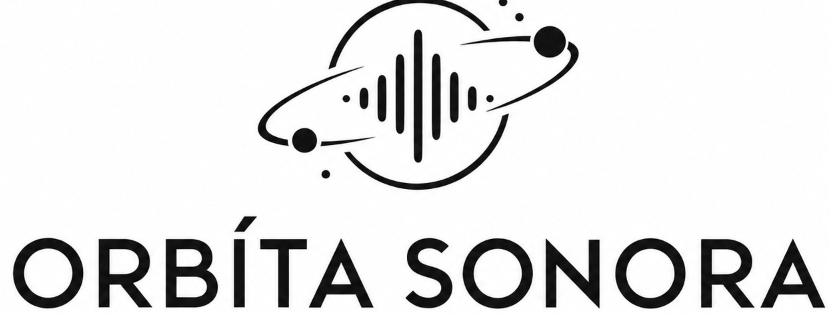
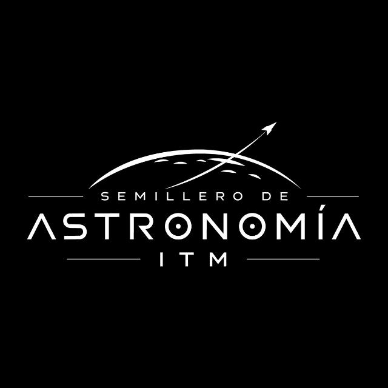
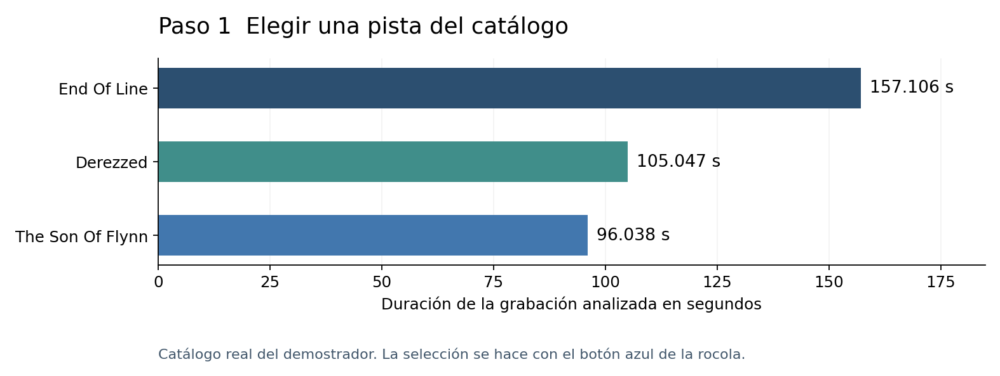
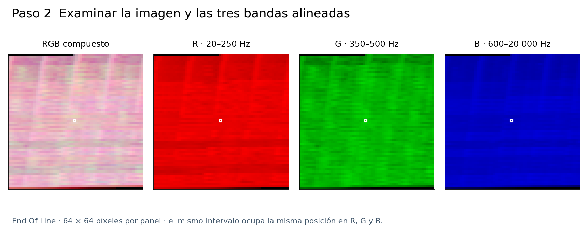
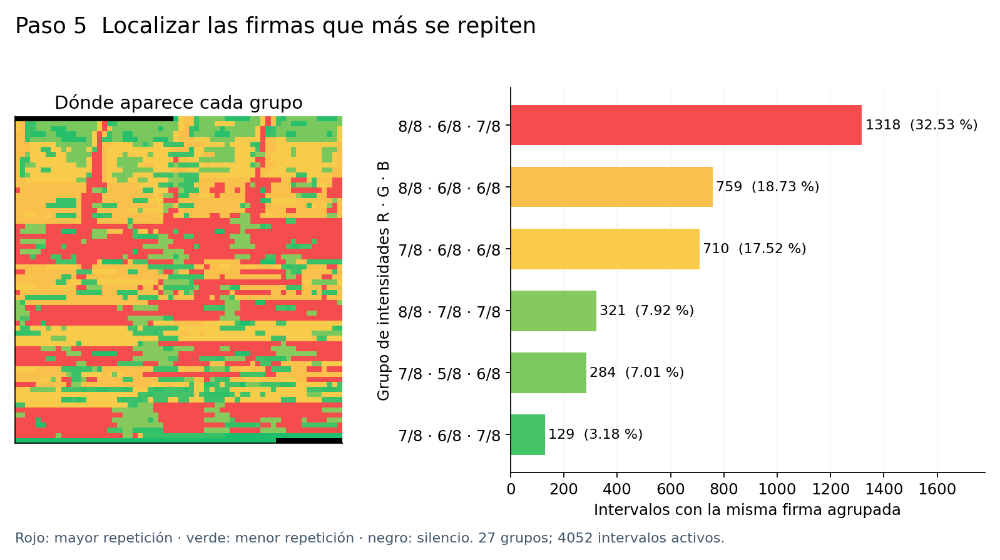
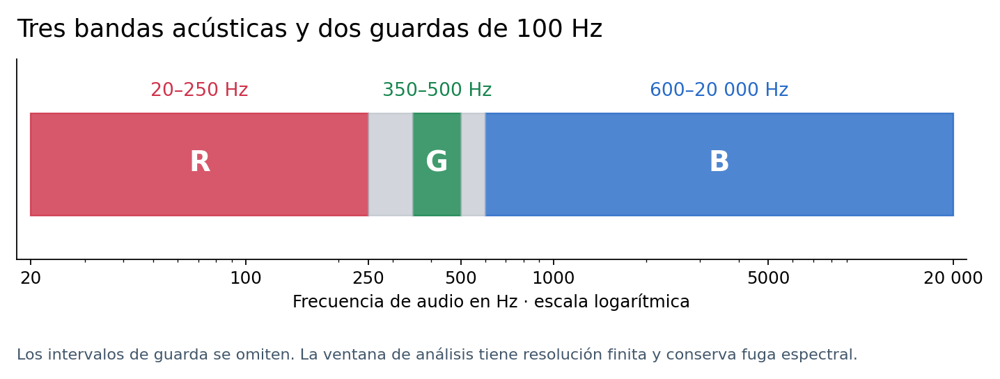
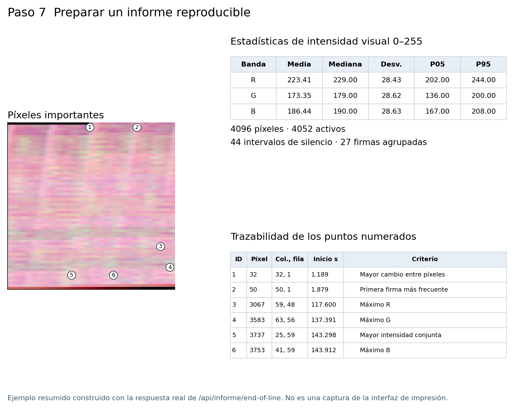

<div align="center">
  
  
  
</div>

# Órbita Sonora

**Website for image processing in the sound domain**

Órbita Sonora es una aplicación de **ORBIDATA ANALYTICS**, desarrollada en el ámbito del **Semillero de Astronomía, Instrumentación y Ciencias Espaciales del ITM**. Analiza imágenes y videos, y convierte sus intensidades visuales en música. La rocola permite elegir qué datos mirar, recorrer y escuchar.

[Visor en GitHub Pages](https://orbidataanalytics.github.io/OrbitaSonora/) · [FastAPI en Render](https://orbitasonora.onrender.com/docs) · [Cómo publicar](PUBLICAR.md) · [Qué archivo editar](ARQUITECTURA.md)

## 1. Qué hacemos con los datos

| Producto | Qué permite hacer |
| --- | --- |
| Recorrido RGB y firma del píxel | Leer la composición y los tres canales, localizar una coordenada y comparar cambios de color a lo largo del recorrido. |
| Mapa de ocupación | Encontrar firmas frecuentes en rojo, intermedias en amarillo y menos frecuentes en verde. |
| Informe HTML, impresión/PDF y JSON | Revisar las imágenes, histogramas, estadísticos, píxeles destacados, configuración de la zona sonora y eventos del arreglo. |
| Sonificación y partituras | Escuchar y exportar el WAV RGB por celda, seguir las tres bandas y ensayar un arreglo para instrumentos. Exportar MIDI y MusicXML o imprimir las partes con tablatura. |
| Visor GIS | Ubicar datos compatibles por coordenadas WGS84 y verlos en mapa 2D o globo 3D. |
| Interpretaciones | Asociar una presentación en video a cada paquete. Mezclar tres grabaciones con el video y exportar un MP4. |

Sirve para explorar visualizaciones ambientales y astronómicas, comparar regiones de color, identificar transiciones y enseñar a relacionar datos con sonido. El arreglo usa convenciones musicales elegidas por el usuario y también puede tocarse en un ensamble. [Ver el boceto conceptual](docs/img/boceto-conceptual.png).

## 2. Cómo se usa

### 2.1 Abrir un paquete y elegir el medio

1. Pulsa el vinilo o el botón azul de la rocola. Elige un paquete por su título y portada. En el submenú usa **Imágenes** o **Videos** y selecciona un archivo.
2. Si quieres probar otra fuente, elige **Agregar paquete**. Pega una página de NASA SVS, varias URL directas o selecciona archivos del equipo. Puedes elegir título y portada. Los paquetes agregados allí se guardan en tu navegador. Para agregarlos al catálogo común, abre [PUBLICAR.md](PUBLICAR.md#agregar-o-quitar-fuentes-del-catálogo).
3. Abre **Medio y análisis** para ver el archivo y ajustar su recorrido. En **Video fuente sincronizado**, el cursor marca la celda activa. Desmarca **Seguir la reproducción** para usar los controles del video. El catálogo abre la descarga original de la variante elegida. Si la fuente o el formato impiden abrirla, descarga el archivo y cárgalo desde tu equipo. Para videos largos puedes elegir el segundo de inicio.



### 2.2 Verificar el fondo y hacer el recorrido

1. Usa **Quitar fondo uniforme** para retirar un color dominante conectado al borde. Comprueba las muestras excluidas. Usa **Delimitar área** para marcar una región con fondo complejo o **Usar transparencia original** para conservar las regiones opacas tal como llegan. En video se calcula la máscara por fotograma muestreado y el área dibujada se aplica a todo el tramo.
2. Elige **Líneas por filas**, **Serpentina por filas**, **Curva de Hilbert**, **Radial** o **Zigzag diagonal**. Ajusta la cuadrícula de 8 × 8 a 128 × 128 y la velocidad de 0,5× a 2×. Con **Zona sonora 1 × 1**, cada celda usa sus propios valores RGB. Puedes elegir conversión logarítmica o lineal de intensidad a frecuencia.
3. Pulsa **Sonificar píxeles RGB** para oír las frecuencias por celda. Las tres partituras espectrales muestran Hz con una ventana ajustable hasta 0,5 s. La barra de tiempo, el video y los visores RGB siguen el recorrido. En los recorridos por filas se resalta la fila activa. Pulsa una celda o un instante de la partitura espectral para ubicarlo. **WAV de píxeles RGB** exporta esta señal.
4. Pulsa **Marcar píxel** para guardar el instante, la fila y la columna. Si el medio tiene georreferencia, verás las marcas en el mapa y podrás descargarlas con **Exportar marcas SIG**. En video, GeoJSON incluye el segundo del archivo. Una ubicación de tipo punto se conserva como referencia común. Cuatro esquinas permiten calcular una ubicación por píxel.
5. Prepara el informe. Elige **Imprimir / PDF** o descarga el HTML. **Descargar datos** guarda ambas intensidades, los métodos, las estadísticas y la lista de eventos del arreglo en JSON.





### 2.3 Tocar la partitura y mezclar en el DAW

1. Al cargar un medio aparece **Partitura del arreglo**. Selecciona la vista general o una parte R, G o B. En **Ajustes de composición** puedes cambiar la tónica, la escala, el tempo, el compás y la afinación. El nivel inicial de las cuerdas usa hasta el traste 5. En 6/8 el tempo se expresa en negras con puntillo.
2. Pulsa el botón verde de la rocola o **Tocar arreglo**. El cursor del pentagrama sigue las notas que se están escuchando. Elige un bloque de compases y pulsa **Ir al compás** para ensayarlo.
3. En **DAW · Instrumentación RGB**, selecciona un instrumento por pista. **Probar** reproduce una nota de esa pista. Si el arreglo está sonando, el reproductor conserva su posición al aplicar el instrumento nuevo y actualiza el pentagrama y la tablatura. **Solo** escucha las pistas seleccionadas y **Mute** silencia la pista. Para usar una muestra propia, elige **Muestra WAV del usuario** y carga el archivo.
4. **WAV del arreglo** guarda la interpretación y su mezcla. **MIDI del arreglo** guarda las notas, el tempo y los programas de instrumento. **MusicXML** e **Imprimir / PDF** usan la vista general o la parte que tengas abierta. Las muestras WAV se conservan en el audio exportado, mientras el MIDI identifica el programa para el instrumento receptor.

La partitura se vuelve a calcular al cambiar el recorrido, la cuadrícula, la máscara, la zona sonora o la composición. El nombre del medio, la cuadrícula, la escala de frecuencias y la velocidad figuran sobre el pentagrama.

### 2.4 Entrada MIDI y RGB en vivo

Abre **DAW → Entrada MIDI y RGB en vivo → Conectar**. El visor genera la URL WebSocket de la sesión. Usa **Probar conexión** para oír un evento y verlo en el historial. Otras aplicaciones pueden abrir esa URL y enviar mensajes JSON. `line_id` usa 1 para rojo, 2 para verde y 3 para azul. `x` e `y` son opcionales y se normalizan de 0 a 1.

```json
{"type":"note","line_id":2,"note":64,"velocity":95,"duration_ms":350,"timestamp_ms":1200}
```

```json
{"type":"rgb","rgb":[120,180,70],"x":0.4,"y":0.6,"duration_ms":220,"timestamp_ms":1450}
```

También puedes cargar un archivo MIDI o descargar la captura en MIDI. La entrada RGB en vivo recibe un píxel por evento y usa su valor tal como llega. Para aplicar 70/30 desde un emisor externo, calcula el valor zonal en el emisor antes de enviarlo.

### 2.5 Ver o publicar una interpretación

1. Elige un paquete y abre **Interpretaciones**. La ventana muestra la carpeta correspondiente, por ejemplo `videos/svs_5313/`, y permite elegir las grabaciones disponibles.
2. Abre **Mezclar una grabación con tres pistas** y carga un video y tres audios. Si grabaste por separado, ajusta la ganancia y la alineación de cada pista. Un valor positivo en ms retrasa la entrada. Usa la primera palmada o una señal común para alinear las tomas.
3. Descarga el MP4 y colócalo en la carpeta del paquete. Usa nombres como `interpretacion.mp4` o `ensayo_01.mp4`. Si quieres actualizar el índice de videos para cualquier nombre, ejecuta `python -m scripts.indexar_videos`. Luego publica los cambios. [Guía de GitHub Desktop](PUBLICAR.md).
4. Cada paquete tiene una carpeta para tus interpretaciones.

## 3. Fundamento físico, estadístico y musical

### 3.1 Imagen, radiancia y color

Un píxel RGB de una visualización entrega tres intensidades de color. Una imagen GeoColor o una composición de falsos colores puede combinar mediciones, modelos o tablas de color. Para inferir radiancia o reflectancia se requieren las bandas originales, longitudes de onda, unidades, geometría y calibración. Hz en el visor expresa la frecuencia de **audio sintetizado**. La frecuencia electromagnética original, cuando se conoce la longitud de onda `λ`, se relaciona por `ν = c/λ`. [NOAA GeoColor](https://www.star.nesdis.noaa.gov/GOES/).

| Canal | Síntesis de referencia | Guarda posterior | Instrumento inicial del arreglo |
| --- | --- | --- | --- |
| R | 20–250 Hz | 250–350 Hz | Bajo eléctrico |
| G | 350–500 Hz | 500–600 Hz | Guitarra estándar |
| B | 600–20 000 Hz | — | Sintetizador |



### 3.2 Píxeles, recorrido y zona sonora

Una cuadrícula de lado `L` tiene `N = L²` posiciones. Cada celda dura `T/N`, donde `T` es la duración base dividida por la velocidad elegida. El índice activo es `min(N − 1, floor(tN/T))` y las tres pistas comparten la coordenada. Por líneas, cada fila se lee de izquierda a derecha y la siguiente empieza de nuevo a la izquierda. La serpentina alterna el sentido de las filas. Hilbert visita todas las celdas saltando siempre a una vecina con borde común. El recorrido radial ordena por distancia al centro y el zigzag alterna el sentido de las diagonales. El video avanza por tramos de hasta 60 s y hasta 120 fotogramas muestreados.

La transparencia original se conserva. La máscara automática estima un color uniforme en el borde y retira los píxeles cercanos a ese color conectados al perímetro por cuatro vecinos. En escenas con movimiento o fondos complejos comprueba el resultado y ajusta la tolerancia o el área de interés. Las regiones excluidas quedan fuera de los estadísticos y aportan silencio a la señal de referencia.

Para cada canal y cada muestra válida, se usa la siguiente mezcla. El promedio zonal usa exclusivamente los vecinos válidos del **mismo fotograma**. La muestra central aporta su 70 % por separado. En el borde se recorta la ventana a la cuadrícula. Con tamaño 1 × 1 o sin vecinos válidos se usa el valor del centro. Se pueden elegir 1, 3, 5, 7, 9, 15 o 21 píxeles de lado.

```text
RGB sonoro = redondear(0.70 × RGB del píxel + 0.30 × promedio RGB de la zona)
```

### 3.3 Estadísticos, firmas y semáforo

El gráfico de la firma visual conserva el RGB medido de cada píxel muestreado. Para `k` niveles, cada intensidad `v` cae en el grupo `floor(kv/256)`. La firma agrupa tres niveles. Su ocupación es `100 × conteo del grupo / total de píxeles válidos con señal`. El semáforo interpola verde, amarillo y rojo entre las frecuencias observadas. Las muestras válidas sin señal se muestran en negro y los píxeles excluidos o pendientes, en gris.

El informe incluye mínimo, máximo, media aritmética, mediana, desviación estándar poblacional, percentiles 5 y 95 por interpolación lineal e histogramas de 16 intervalos fijos. Marca máximos por canal, máximo conjunto de las tres intensidades, mayor distancia euclídea RGB entre dos muestras consecutivas válidas y primera aparición de la firma más frecuente. También admite marcas manuales.



### 3.4 Tono de referencia y arreglo interpretable

Para `v > 0`, la opción logarítmica usa `f = f_min × (f_max / f_min)^((v − 1)/254)`. La opción lineal usa `f = f_min + (f_max − f_min) × (v − 1)/254`. Tone.js genera tres ondas sinusoidales y programa la frecuencia y la amplitud de cada banda con los valores de la celda activa. La amplitud de pico por pista antes de efectos es `0.30 × volumen_pista × v/255`. Una intensidad 0 silencia esa banda. El WAV de píxeles y el WAV del arreglo se generan en estéreo a 48 kHz.

El arreglo resume en cada subdivisión las frecuencias de las celdas que el recorrido visita durante ese intervalo, ponderadas por su tiempo de lectura. Lleva ese valor a una nota de la escala y al registro del instrumento. La intensidad RGB determina la dinámica. Para facilitar la ejecución se limitan los saltos y, en instrumentos de cuerda, se buscan trastes cercanos. Los intervalos sin señal se escriben como silencios. La percusión, si se elige, asigna el golpe según el valor del intervalo. El último compás se completa con silencios hasta su frontera métrica.

El DAW aplica panorama en función de X y, si lo activas, filtro según Y. La reverb aumenta con la distancia de la celda al centro. MusicXML guarda compás, tempo, armadura, silencios, figuras, digitación y dinámicas. [Tone.js 15.1.22](https://tonejs.github.io/docs/15.1.22/classes/Oscillator.html) · [MusicXML 4.0](https://www.w3.org/2021/06/musicxml40/).

### 3.5 Georreferencia y medios compatibles

El GIS recibe un punto de referencia o cuatro esquinas en orden superior izquierda, superior derecha, inferior derecha e inferior izquierda, en **longitud, latitud WGS84**. Un GeoTIFF compatible aporta esa información desde su CRS y transformación. La capa de cuatro esquinas aproxima la posición de visualizaciones con deformaciones complejas. El mapa no deduce coordenadas de una animación de cámara desconocida.

| Entrada | Lectura |
| --- | --- |
| JPEG, PNG, GIF, WebP, BMP, AVIF, ICO y variantes | Navegador o Pillow. Una imagen animada se lee como imagen fija inicial. |
| TIFF, GeoTIFF, JPEG 2000 | Rasterio o Pillow. En alta profundidad se pueden usar percentiles 2–98 para la vista. |
| HEIC o HEIF | Pillow con pillow-heif. |
| RAW de cámara | LibRaw mediante rawpy para DNG, CR2, CR3, NEF, ARW, RAF, RW2, ORF y otros, según cámara y compresión. |
| FITS | Astropy para el plano visualizable. |
| MP4, WebM, MOV, MKV, AVI y otros videos | Navegador o PyAV según contenedor y códec. Para la mezcla final se usa FFmpeg. |

Se pueden introducir archivos locales y URL directas públicas. La API normaliza imágenes de hasta 40 MiB y convierte videos de hasta 80 MiB cuando hace falta. Un reproductor externo requiere acceso a sus archivos directos para analizar cuadros. La mezcla de interpretación recibe video de hasta 95 MiB y 5 minutos, más tres audios de hasta 36 MiB cada uno. Devuelve MP4 H.264 con AAC estéreo. [FFmpeg](https://ffmpeg.org/ffmpeg-filters.html).

## 4. Fuentes precargadas


| Paquete | Imágenes | Videos |
| --- | ---: | ---: |
| [Earth Information Center](https://svs.gsfc.nasa.gov/gallery/earth-information-center/) | 290 | 179 |
| [Change in Night Lights between 2012 and 2023](https://svs.gsfc.nasa.gov/5313/) | 1 | 1 |
| [Global Sea Surface Currents and Temperature · grupo 349716](https://svs.gsfc.nasa.gov/3912/#media_group_349716) | 1 | 0 |
| [GEOS Aerosols (2025)](https://svs.gsfc.nasa.gov/5669/) | 3 | 0 |
| [Air Quality Model Runs](https://svs.gsfc.nasa.gov/5533/) | 4 | 4 |
| [Perpetual Ocean 2](https://svs.gsfc.nasa.gov/5425/) | 13 | 9 |
| [Lightning Events Detected from the ISS](https://svs.gsfc.nasa.gov/5011/) | 2 | 2 |
| [A 3D View of an Atmospheric River](https://svs.gsfc.nasa.gov/4960/) | 4 | 3 |
| [GEDI Forest Height](https://svs.gsfc.nasa.gov/4950/) | 23 | 12 |

Los recuentos corresponden a elementos del catálogo. Las variantes de resolución y formato aparecen dentro de cada elemento. La página 5425 aparece una vez. El grupo 349716 ofrece la misma imagen en JPG, PNG y TIFF. La galería incluye sus tarjetas multimedia y hasta dos niveles de páginas enlazadas. [API de NASA SVS](https://svs.gsfc.nasa.gov/help/).

El botón **Descarga original** abre el archivo seleccionado. El paquete incluye copias sin editar del PNG de GEOS Aerosols, el JPG de luces nocturnas y el WebM de GEDI. La sonificación y el arreglo se calculan con los píxeles y fotogramas de esos archivos. Las demás referencias se descargan desde su URL. Si el navegador necesita ayuda por el códec o los permisos de lectura de píxeles, la API de Render accede a la misma descarga. Para videos con conversión, la API procesa el tramo solicitado y conserva el segundo de origen en los informes y en GeoJSON. El archivo que se analizó aparece por nombre junto al control de descarga. Las huellas verificables de los archivos incluidos están en [ARCHIVOS_NASA_SHA256.txt](docs/ARCHIVOS_NASA_SHA256.txt).


## 5. Ejecutar y mantener

```bash
python -m pip install -r requirements.txt
python -m scripts.servir
```

Abre [el visor local](http://127.0.0.1:8000/visor) o [la documentación de la API](http://127.0.0.1:8000/docs). La web se publica sin compilar. Puedes comprobarla con `python pruebas/verificar.py` y `node pruebas/sonificacion.mjs`.

| Si quieres cambiar… | Edita… |
| --- | --- |
| Qué páginas aparecen | `datos/fuentes-svs.json` y el comando `python -m scripts.actualizar_catalogo --vistas`. |
| Título, portada o medio de un disco | `datos/paquetes/<paquete>/paquete.json`. Para el título de la lista general, actualiza también `datos/paquetes/catalogo.json`. |
| Un video de interpretación | `videos/<carpeta_del_paquete>/`. Añade o elimina un MP4 y ejecuta `python -m scripts.indexar_videos`. |
| Tamaños de zona y peso del píxel | `web/js/visor/estadistica-zonal.js`. La web toma del módulo las opciones de tamaño. |
| Instrumentos, timbres y valores iniciales | `web/js/visor/audio-pistas.js`. En `web/js/visor/arreglo.js` están las afinaciones y las reglas musicales. |
| Colores y aspecto de la rocola | `web/css/rocola-home.css`. |
| Lógica de importación y conversión | `api/visor/` y `api/rutas/visor.py`. |

[Mapa de módulos y ejemplos de edición](ARQUITECTURA.md) · [Publicación rápida](PUBLICAR.md)

## 6. Licencia y créditos

Código bajo [Apache License 2.0](LICENSE). Los logos de ORBIDATA ANALYTICS, Órbita Sonora y el Semillero de Astronomía ITM se incluyen tal como los aportó el equipo. Las fuentes de NASA, NOAA y los recursos de terceros conservan sus créditos y licencias en [NOTICE](NOTICE).
